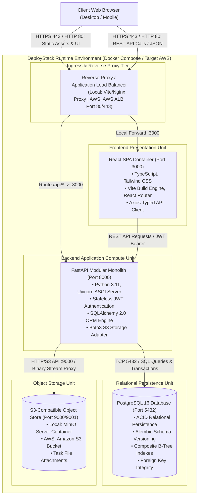

# DeployStack

[](https://github.com/mohmmad-akeeb/DeployStack/actions/workflows/backend-ci.yml)
[](https://github.com/mohmmad-akeeb/DeployStack/actions/workflows/frontend-ci.yml)
[](https://github.com/mohmmad-akeeb/DeployStack/actions/workflows/terraform-ci.yml)

> Production-style three-tier web application with Terraform-based AWS infrastructure, Docker, CI/CD, and automated testing.

---

## Project Overview

**DeployStack** is a production-engineered reference project and full-stack team task and issue management platform. It demonstrates how to build, containerize, validate, and prepare an enterprise three-tier web application for high-availability deployment on Amazon Web Services (AWS) using Infrastructure as Code (IaC) with OpenTofu/Terraform—all while maintaining complete parity with a zero-cost local developer runtime.

### Problem Addressed

Modern software systems require tight alignment between application architecture and cloud infrastructure. Engineering teams often face:
- **Dev/Cloud Parity Gaps:** Applications that run locally in containers behave unpredictably when mapped onto multi-tier VPC topologies, auto-scaling groups, and managed cloud databases.
- **Prohibitive Cloud Costs for Prototyping:** Developers frequently incur recurring cloud charges simply to validate IaC templates and multi-tier networking topologies.
- **Incomplete DevOps Reference Architectures:** Many open-source samples provide toy code without database migration lifecycles, structured error contracts, automated unit/mock tests, or least-privilege security controls.

DeployStack solves these challenges by delivering an end-to-end, functional task and project management application paired with clean Terraform modules, multi-stage Docker builds, automated GitHub Actions CI pipelines, and mock-based infrastructure testing.

### Project Objectives

- Provide a reliable, modular monolith architecture designed for horizontal scaling.
- Demonstrate production-grade Infrastructure as Code (IaC) using reusable Terraform modules with environment separation (`dev` and `production`).
- Enable seamless, zero-cost local development using Docker Compose, MinIO S3-compatible storage, and PostgreSQL.
- Guarantee strict type safety, domain data validation, and comprehensive automated test coverage across frontend, backend, and infrastructure.

---

## Key Features

DeployStack implements a focused, robust set of production-grade features:

- **Authentication & User Management:**
  - Secure user registration and authentication using stateless JSON Web Tokens (RFC 7519).
  - Cryptographic password hashing with `bcrypt` and strong password complexity policies.
  - User profile management with password change verification.
- **Project & Workspace Management:**
  - Multi-project workspace creation and management.
  - Role-Based Access Control (RBAC) with granular permissions (`owner`, `admin`, `member`, `viewer`).
  - Project member invitation and removal with tenant boundary isolation.
- **Task & Issue Lifecycle:**
  - Full CRUD task operations with priorities (`low`, `medium`, `high`, `urgent`), due dates, and multiple assignees.
  - Task status workflows: `todo`, `in_progress`, `completed`.
- **Interactive Kanban Board:**
  - Visual status columns with real-time state transitions and status badge indicators.
  - Project-level Kanban filtering and card inspection modals.
- **Secure File Attachments:**
  - File attachment uploads to S3-compatible object storage (MinIO locally / Amazon S3 on AWS).
  - Reverse-proxy streaming file downloads enforcing JWT authorization checks before byte streaming.
  - Strict upload validation (file size limits up to 10 MB and MIME type inspection).
- **Audit Logging & Activity Tracking:**
  - Automatic event logging for project creations, member updates, task modifications, and file attachments.
  - Project activity timeline and dashboard activity feeds.
- **Dashboard Analytics:**
  - Aggregate statistics reporting total projects, assigned tasks, completion percentages, and overdue tasks.

---

## Architecture

DeployStack employs a classic three-tier architecture maintaining parity between the local Docker Compose runtime plane and the target AWS cloud infrastructure.



### Layer Details

1. **Presentation Layer (Frontend):**
   - Single Page Application (SPA) built with React 18, TypeScript, Vite, and Tailwind CSS.
   - Client-side navigation via React Router 6, authentication state context, and typed Axios HTTP interceptors handling JWT injection.
   - Deployed locally via Node/Vite development server or Nginx production container; maps to Amazon S3 static hosting or ALB in AWS.
2. **Application Layer (Backend):**
   - Modular monolith built with FastAPI and Python 3.11 running on Uvicorn.
   - Clean layered architecture separating Routers (`api/v1`), Domain Services (`services/`), Data Repositories (`repositories/`), Schemas (`schemas/`), and Models (`models/`).
   - Stateless compute unit enabling horizontal auto-scaling behind an AWS Application Load Balancer (ALB) and EC2 Auto Scaling Group (ASG).
3. **Database Layer:**
   - PostgreSQL 16 providing ACID-compliant relational data persistence.
   - Schema versioning and reproducible migrations managed via Alembic.
   - Foreign key cascading, composite indexes, and strict check constraints.
   - Maps to Amazon RDS PostgreSQL Multi-AZ in the production AWS architecture.
4. **Storage Layer:**
   - S3-compatible object storage for file attachments.
   - Local execution powered by MinIO with private bucket policies; target AWS architecture backed by Amazon S3 with private ACLs and server-side encryption.
5. **Infrastructure Layer:**
   - Modular Terraform definitions specifying VPC networking, subnets, route tables, security groups, ALB, Auto Scaling Groups, RDS, and S3.

---

## Technology Stack

| Category | Technology | Purpose |
| :--- | :--- | :--- |
| **Frontend** | React 18, TypeScript 5, Vite 5, Tailwind CSS 3 | Responsive user interface, component architecture, and styling |
| **Icons & Routing** | Lucide React, React Router 6 | Vector iconography and client-side application routing |
| **Backend** | Python 3.11, FastAPI, Pydantic V2, Uvicorn | High-performance asynchronous REST API framework |
| **Persistence & ORM** | PostgreSQL 16, SQLAlchemy 2.0, Alembic | Relational database, SQL abstraction, and database migrations |
| **Authentication** | Python-Jose, Passlib, Bcrypt | Stateless RFC 7519 JWT generation and secure password hashing |
| **Object Storage** | MinIO, Boto3, Amazon S3 | S3-compatible object storage and SDK client integration |
| **Containerization** | Docker, Docker Compose, Alpine Linux | Multi-stage container builds and local multi-container orchestration |
| **Infrastructure as Code** | Terraform (OpenTofu compatible) | Declarative cloud resource provisioning on AWS |
| **Cloud Platform** | Amazon Web Services (AWS) | Target deployment architecture (VPC, EC2, ASG, ALB, RDS, S3) |
| **CI/CD** | GitHub Actions | Automated linting, type-checking, build validation, and IaC tests |
| **Testing & Quality** | Pytest, AnyIO, Ruff, Mypy, Terraform Test | Backend test suite, code analysis, type verification, and IaC unit tests |

---

## Repository Structure

```text
DeployStack/
├── .github/
│   └── workflows/
│       ├── backend-ci.yml           # Backend lint (Ruff), type check (Mypy), and Pytest
│       ├── frontend-ci.yml          # Frontend dependencies (npm ci) and Vite build
│       └── terraform-ci.yml         # Terraform fmt, init, validate, and mock unit tests
├── application/
│   ├── backend/
│   │   ├── alembic/                 # Database schema migrations
│   │   ├── app/
│   │   │   ├── api/                 # API endpoints, dependencies, and v1 router
│   │   │   ├── core/                # Config, database engine, security, storage
│   │   │   ├── models/              # SQLAlchemy 2.0 ORM domain models
│   │   │   ├── repositories/        # Data access layer and DB queries
│   │   │   ├── schemas/             # Pydantic v2 validation models
│   │   │   └── services/            # Business logic and transaction orchestration
│   │   ├── tests/                   # Pytest test suite (39 comprehensive tests)
│   │   ├── Dockerfile               # Production multi-stage backend container
│   │   ├── Dockerfile.dev           # Development container configuration
│   │   ├── pyproject.toml           # Python tool configurations (Ruff, Mypy, Pytest)
│   │   └── requirements.txt         # Production backend dependencies
│   └── frontend/
│       ├── src/
│       │   ├── api/                 # Axios HTTP client and TypeScript interfaces
│       │   ├── components/          # Reusable UI components, modals, and layout
│       │   ├── context/             # AuthContext and state management
│       │   ├── pages/               # Dashboard, Kanban, Projects, Profile, Auth pages
│       │   └── routes/              # Route definitions and protected route wrappers
│       ├── Dockerfile               # Multi-stage build with Nginx production runtime
│       ├── package.json             # NPM dependencies and scripts
│       ├── tailwind.config.js       # Tailwind CSS design system tokens
│       ├── tsconfig.json            # Strict TypeScript configuration
│       └── vite.config.ts           # Vite build and proxy configuration
├── docs/
│   ├── api/                         # OpenAPI specifications (JSON/YAML) and contracts
│   ├── architecture/                # System architecture, C4 diagrams, and ADRs
│   ├── database/                    # Relational schema reference, DDL, and ERDs
│   ├── DEVELOPMENT_LOG.md           # Engineering implementation log
│   ├── PROJECT_STATUS.md            # Detailed status of all project phases
│   └── requirements.md              # System requirements specification (SRS v1.0.0)
├── infrastructure/
│   ├── environments/
│   │   ├── dev/                     # Dev environment configuration & variables
│   │   └── production/              # Production multi-AZ environment configuration
│   ├── modules/
│   │   ├── compute/                 # EC2 Launch Template & Auto Scaling Group
│   │   ├── database/                # Amazon RDS PostgreSQL Multi-AZ
│   │   ├── load-balancer/           # AWS Application Load Balancer & Target Groups
│   │   ├── networking/              # VPC, 6 Subnets, Internet Gateway, NAT Gateways
│   │   ├── security/                # Layered Security Groups (ALB, App, DB)
│   │   └── storage/                 # Private Amazon S3 bucket with encryption
│   └── tests/
│       └── networking.tftest.hcl    # Terraform mock-provider unit tests
├── .env.example                     # Environment variable template
├── .gitignore                       # Git ignore rules for secrets, builds, and caches
├── docker-compose.yml               # Multi-container orchestration (Zero-cost local runtime)
├── Makefile                         # Developer CLI commands
├── PROJECT_SPECIFICATION.md         # Original project scope and engineering requirements
└── README.md                        # Master repository documentation
```

---

## Getting Started

### Prerequisites

Ensure the following tools are installed on your workstation:
- [Docker](https://docs.docker.com/get-docker/) (v24+) and [Docker Compose](https://docs.docker.com/compose/) (v2.20+)
- [Node.js](https://nodejs.org/) (v20 LTS or higher) and `npm`
- [Python](https://www.python.org/) (v3.11 or higher)
- [Git](https://git-scm.com/)

### Clone Instructions

```bash
git clone https://github.com/mohmmad-akeeb/DeployStack.git
cd DeployStack
```

### Environment Configuration

Copy the template environment file:

```bash
cp .env.example .env
```

The default values in `.env.example` are pre-configured for local execution with zero cloud billing.

### Docker Compose Startup

Start all four application containers (PostgreSQL, MinIO, Backend, and Frontend) in detached mode:

```bash
make up
# Or directly via Docker Compose:
# docker compose up -d
```

Check the health status of all running containers:

```bash
make ps
# or: docker compose ps
```

### Service Access URLs

| Component | URL | Credentials / Notes |
| :--- | :--- | :--- |
| **Frontend Web UI** | [http://localhost:3000](http://localhost:3000) | Dashboard, Projects, Kanban Board |
| **Backend REST API** | [http://localhost:8000](http://localhost:8000) | FastAPI ASGI Application |
| **Interactive API Docs** | [http://localhost:8000/docs](http://localhost:8000/docs) | Swagger UI for exploring endpoints |
| **Health Check** | [http://localhost:8000/api/v1/health](http://localhost:8000/api/v1/health) | API status & database connection ping |
| **MinIO Web Console** | [http://localhost:9001](http://localhost:9001) | User: `minioadmin` / Pass: `minioadmin` |
| **PostgreSQL Database** | `localhost:5432` | DB: `deploystack_db` / User: `deploystack` |

To stop the running services:

```bash
make down
# or: docker compose down
```

---

## Infrastructure

DeployStack's cloud infrastructure is declared using modular, reusable Terraform components targeting Amazon Web Services (AWS).

> **Zero Cloud Cost Guarantee:** Actual AWS provisioning (`terraform apply`) is strictly optional and not required to run or test the project. All IaC code is validated and tested using static validation and mock unit tests without incurring cloud charges.

### Terraform Module Structure

The infrastructure code is organized under `infrastructure/modules/`:

- **`networking`:** Provisions a custom VPC, 2 public subnets across 2 Availability Zones, 2 private application subnets, 2 private database subnets, Internet Gateway, NAT Gateways, and isolated route tables.
- **`security`:** Creates least-privilege security groups with explicit ingress/egress rules linking tiers (Internet → ALB → App instances → RDS).
- **`load-balancer`:** Provisions an AWS Application Load Balancer (ALB), HTTP/HTTPS listeners, and health-checked target groups.
- **`compute`:** Configures EC2 Launch Templates with user data scripts, IAM instance profiles, and Auto Scaling Groups (ASG) in private application subnets.
- **`database`:** Provisions an Amazon RDS PostgreSQL Multi-AZ deployment in private database subnets with automated backup retention and encryption.
- **`storage`:** Configures an Amazon S3 bucket with public access block, server-side encryption (AES-256), and lifecycle policies for file attachments.

### Environment Separation

- **`infrastructure/environments/dev`:** Single-AZ RDS, cost-conscious single NAT Gateway, reduced auto-scaling thresholds.
- **`infrastructure/environments/production`:** High-availability Multi-AZ RDS, redundant NAT Gateways across Availability Zones, resilient ASG scaling policies.

### Terraform Validation and Testing

To validate Terraform syntax and formatting:

```bash
cd infrastructure
terraform fmt -check -recursive
terraform -chdir=environments/dev init -backend=false
terraform -chdir=environments/dev validate
terraform -chdir=environments/production init -backend=false
terraform -chdir=environments/production validate
terraform -chdir=tests test -verbose
```

---

## Testing

DeployStack includes automated test suites across all tiers:

### 1. Backend Test Suite

The backend includes 39 unit and integration tests using Pytest, covering authentication, database rollback mechanisms, models, project RBAC, tasks, attachments, and activity logging:

```bash
# Run via Makefile shortcut
make test-backend

# Or directly in application/backend:
cd application/backend
pytest -v
```

### 2. Frontend Build Verification

Validates TypeScript types and compiles production bundles with Vite:

```bash
# Run via Makefile shortcut
make test-frontend

# Or directly in application/frontend:
cd application/frontend
npm run build
```

### 3. Code Quality & Linting

```bash
# Run linting across application tiers
make lint

# Or manually:
cd application/backend && ruff check .
```

---

## CI/CD Pipelines

DeployStack uses GitHub Actions to run automated checks on every push and pull request to the `main` branch:

1. **Backend CI (`.github/workflows/backend-ci.yml`):**
   - Sets up Python 3.11 with pip caching.
   - Installs dependencies from `requirements-dev.txt`.
   - Runs `ruff check .` for code style and linting.
   - Runs `mypy app/` for strict static type checking.
   - Executes the complete Pytest test suite.
2. **Frontend CI (`.github/workflows/frontend-ci.yml`):**
   - Sets up Node.js 20 with npm caching.
   - Runs clean dependency installation via `npm ci`.
   - Executes TypeScript compiler and Vite production build (`npm run build`).
3. **Terraform CI (`.github/workflows/terraform-ci.yml`):**
   - Sets up Terraform CLI (v1.7.5).
   - Validates code formatting across all modules (`terraform fmt -check -recursive`).
   - Initializes and validates both `dev` and `production` environments without remote backends (`-backend=false`).
   - Executes Terraform mock unit tests (`terraform -chdir=tests test -verbose`).

---

## Security Practices

DeployStack adheres to defense-in-depth principles:

- **Zero Committed Secrets:** All credentials, keys, and tokens are read strictly from environment variables. `.env` and secret files are explicitly ignored in `.gitignore`.
- **Stateless JWT Authorization:** Access tokens are signed using HMAC-SHA256 (`HS256`) with configurable expiration. Protected endpoints strictly require a valid `Bearer` token.
- **Strong Password Hashing:** Passwords are salted and hashed using `bcrypt`. Validation rules enforce minimum length and character variety (uppercase, lowercase, numbers, special characters).
- **Tenant Isolation & RBAC:** Project membership boundaries are enforced at the service and repository layers. Users cannot read, modify, or delete resources outside their authorized projects.
- **Safe File Streaming:** Object storage credentials are never exposed to the client. File attachments are verified and streamed through backend proxy endpoints.
- **Layered Network Firewalls:** Security groups in the Terraform architecture restrict database access strictly to application instances, and application instances strictly to the ALB.

---

## Project Status

| Phase / Component | Status | Description |
| :--- | :--- | :--- |
| **Requirements & Design** | Completed | Full SRS specification, C4 architecture diagrams, and ADRs documented. |
| **Database Architecture** | Completed | PostgreSQL relational schema, DDL with triggers, indexes, and Alembic migrations. |
| **Backend API Engine** | Completed | FastAPI modular monolith, JWT auth, RBAC, CRUD services, 39 Pytest tests. |
| **Frontend Application** | Completed | React 18, TypeScript, Tailwind CSS, Kanban board, Project modals, API client. |
| **Infrastructure as Code** | Completed | Reusable Terraform modules, dev/production environments, mock unit tests. |
| **Container Orchestration** | Completed | Multi-container Docker Compose with health checks and volume persistence. |
| **CI/CD Automation** | Completed | GitHub Actions workflows for Backend, Frontend, and Terraform validation. |
| **Remote Repository Setup** | In Progress | Initializing public GitHub repository with origin tracking and metadata. |

---

## Roadmap

- [ ] Add end-to-end (E2E) automated browser testing suite with Playwright.
- [ ] Implement automated performance and load testing scenarios using Locust.
- [ ] Add real-time task board updates via WebSockets.
- [ ] Configure OpenTelemetry distributed tracing and metrics with Prometheus and Grafana.
- [ ] Optional deployment to live AWS sandbox using GitHub Actions OIDC role assumption.

---

## Contributing

Contributions, issues, and feature suggestions are welcome!

1. Fork the repository.
2. Create a feature branch (`git checkout -b feature/amazing-feature`).
3. Commit your changes following conventional commit syntax (`git commit -m 'feat: add amazing feature'`).
4. Ensure all tests pass (`make test && make lint`).
5. Push to the branch (`git push origin feature/amazing-feature`).
6. Open a Pull Request.

---

## License

No license has been assigned to this repository yet. The licensing decision is currently unresolved pending project maintainer approval.

---

## Author

**MOHMMAD AKEEB**
- GitHub: [@mohmmad-akeeb](https://github.com/mohmmad-akeeb)
