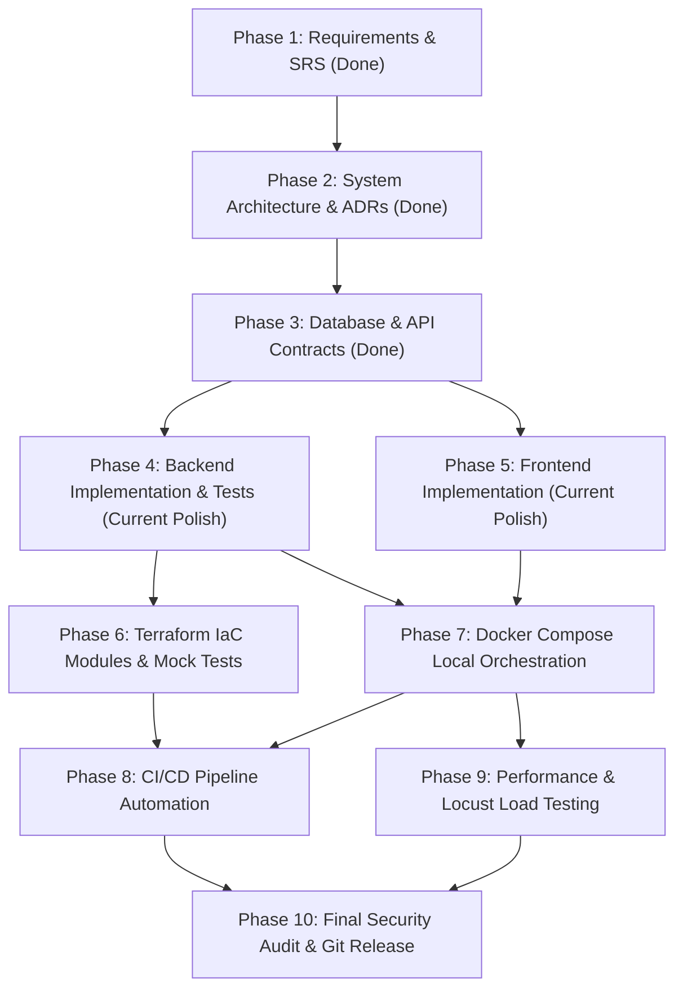
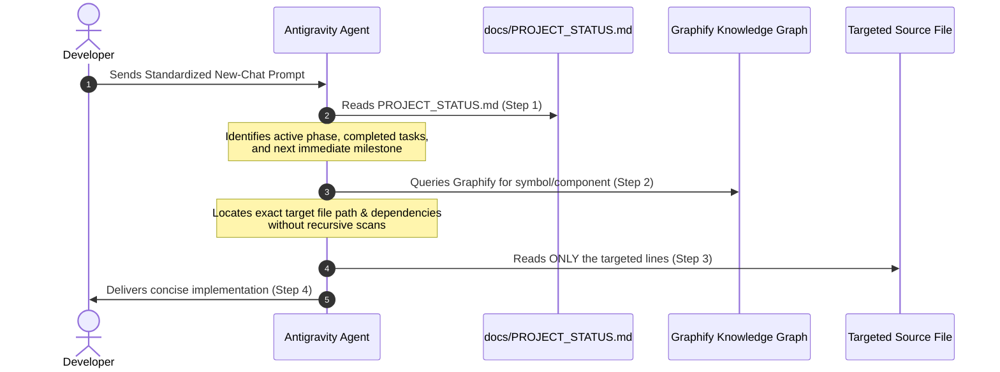
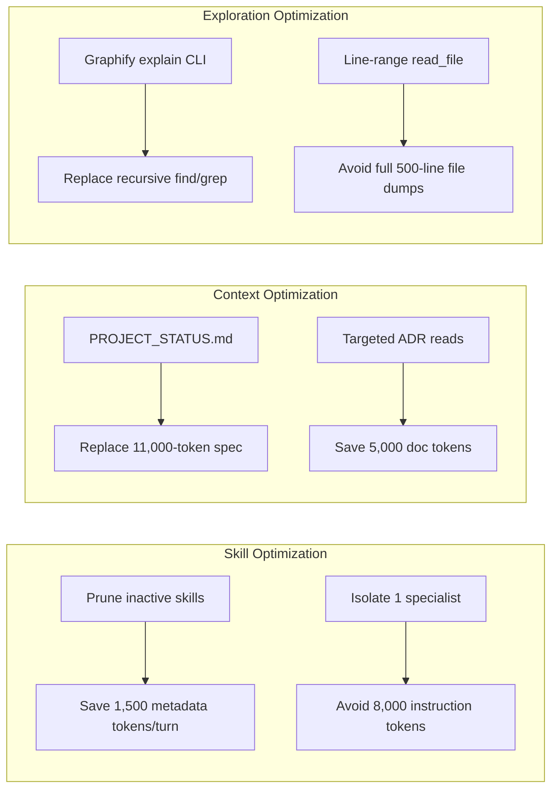
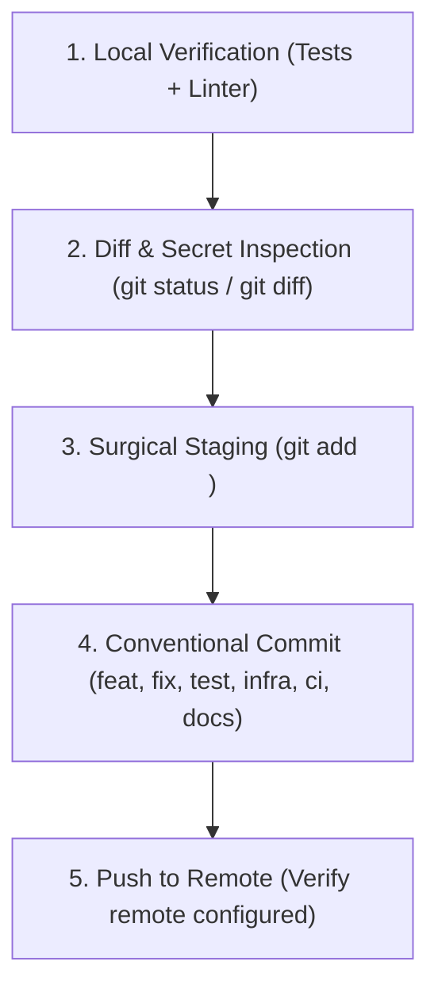

# DeployStack — Antigravity Operating Manual & Token-Efficient Workflow Architecture

**Document Version:** 1.0.0  
**Status:** Active Operating Standard  
**Date:** 2026-11-13  
**Target Project:** DeployStack (Three-Tier Web Application & AWS Infrastructure Automation)  
**Author:** Senior AI Development Workflow Architect & Antigravity Specialist  

---

## Table of Contents

1. [Current Environment Audit](#section-1-current-environment-audit)
2. [Recommended Skill Management Strategy](#section-2-recommended-skill-management-strategy)
3. [Phase-by-Phase Development Workflow](#section-3-phase-by-phase-development-workflow)
4. [New-Chat Management Standard](#section-4-new-chat-management-standard)
5. [Graphify Integration & Optimization](#section-5-graphify-integration--optimization)
6. [Comprehensive Token Optimization Strategy](#section-6-comprehensive-token-optimization-strategy)
7. [Model Selection & Allocation Strategy](#section-7-model-selection--allocation-strategy)
8. [Parallel Execution & Concurrency Strategy](#section-8-parallel-execution--concurrency-strategy)
9. [Development Documentation System & Templates](#section-9-development-documentation-system--templates)
10. [Git & GitHub Milestone Workflow](#section-10-git--github-milestone-workflow)
11. [Reusable Antigravity Prompt Library](#section-11-reusable-antigravity-prompt-library)

---

# Section 1: Current Environment Audit

### 1.1 Repository Architecture & Working Tree Status

A rigorous inspection of `/home/mihawk/ubuntu_data/projects/deploystack` reveals the following verified facts:

*   **Git Repository Structure & Commit History:**
    *   Active Branch: `main`.
    *   Commit Count: Exactly **1 commit** (`03cb4d5 feat: implement DeployStack frontend architecture, pages, and API integrations`).
    *   Tracked Files: Only `application/frontend/` and `.gitignore`.
    *   Remote Configuration: **No remote configured** (`git remote -v` returns empty).
    *   **Untracked Working Tree Files:** A massive volume of critical project files are currently untracked:
        *   `.agent/` (Workspace skills)
        *   `.github/` (Workflows: `backend-ci.yml`, `frontend-ci.yml`, `terraform-ci.yml`)
        *   `GEMINI.md` (Project agent instructions)
        *   `PROJECT_SPECIFICATION.md` & `README.md`
        *   `application/backend/` (Complete FastAPI application, Alembic migrations, Pytest suite, Dockerfile)
        *   `application/frontend/.agent/`, `application/frontend/.agents/`, `skills-lock.json` (Orphaned nested skill directories from external CLI installations)
        *   `docker-compose.yml` & `Makefile`
        *   `docs/` (`requirements.md`, `architecture/`, `database/`, `api/`)
        *   `graphify-out/` (Static graph extraction data)
        *   `infrastructure/` (Terraform modules: `networking`, `security`, `load-balancer`, `compute`, `database`, `storage`, and environments: `dev`, `production`)

### 1.2 Verification of Application & Infrastructure Components

| Layer | Verified Current State | Test / Validation Results | Gaps & Anomalies |
| :--- | :--- | :--- | :--- |
| **Backend** | Python 3.11+, FastAPI, SQLAlchemy 2.0, Alembic, Pydantic V2, Pytest | `mypy app/`: **Passed** (47 source files).<br>`pytest tests/`: **39 passed** (when run inside `application/backend`). | `test_migrations.py` fails when run from repo root due to hardcoded relative `alembic.ini` path.<br>`ruff check .` reports 19 lint errors in alembic/tests. |
| **Frontend** | React 18, TypeScript 5.4, Vite 5.2, Tailwind CSS 3.4, React Router 6, Axios | `npm run build`: **Passed** (Compiled & bundled in 3.58s to `dist/`). | `npm run lint` fails: ESLint configuration missing.<br>Unit/Component tests: **0 tests exist**. |
| **Database** | PostgreSQL 16 schema, Alembic migration `d321b9b313de_initial_schema.py` | Schema DDL & Alembic migrations verified in test suite. | No live database running; tested against SQLite in-memory during Pytest. |
| **Storage** | MinIO local S3-compatible service, `boto3` client abstraction | Storage client initialized with multipart upload/stream capabilities. | Direct end-to-end MinIO bucket integration test depends on Docker container. |
| **Local Runtime** | Docker Compose v5.7.0, Docker Engine 29.9.3 | `docker compose config`: **Syntactically Valid**. | Containers have not been spun up or validated live in this session. |
| **Terraform (IaC)** | 6 reusable modules, 2 environments (`dev`, `production`), mock test file | Terraform code written and modularized. | `terraform` binary is **not installed on Linux host** (`TERRAFORM_NOT_FOUND`). Validation currently relies exclusively on GitHub Actions runner. Only `networking.tftest.hcl` exists; mock tests missing for remaining 5 modules. |
| **CI/CD** | 3 GitHub Actions workflows (`backend-ci`, `frontend-ci`, `terraform-ci`) | YAML syntax valid, targeting GitHub Ubuntu runners. | Workflows are untracked in Git. Frontend workflow does not run tests or linting. |

### 1.3 Documentation & Knowledge Base Status

*   **Existing Authoritative Docs:**
    *   `docs/requirements.md`: Comprehensive SRS v1.0.0.
    *   `docs/architecture/system-architecture.md`: C4 Level 1–3 diagrams, dual-plane execution model.
    *   `docs/architecture/decisions/`: ADR-001 through ADR-010 covering key trade-offs.
    *   `docs/database/schema.md` & `docs/database/schema.sql`: Authoritative schema and DDL.
    *   `docs/api/api-contracts.md`, `openapi.yaml`, `openapi.json`: OpenAPI 3.1 specifications.
*   **Critical Documentation Deficiencies:**
    *   `docs/PROJECT_STATUS.md`: **MISSING**.
    *   `docs/DEVELOPMENT_LOG.md`: **MISSING**.
    *   *Impact:* In `GEMINI.md`, rule 1 commands the agent: *"Read the current project status and development log"*. Because these files are missing, every new agent conversation immediately encounters file-not-found errors and defaults to recursive repository exploration.

### 1.4 Installed Skills & Redundancy Audit

Antigravity loads skills from three distinct discovery directories:
1.  **Workspace Skills** (`/home/mihawk/ubuntu_data/projects/deploystack/.agent/skills/`): 14 installed skills.
2.  **Global Skills** (`~/.gemini/config/skills/`): 5 installed skills.
3.  **Built-in Skills** (`~/.gemini/antigravity/builtin/skills/`): 13 installed skills.
4.  **Nested/Orphaned Skills** (`application/frontend/.agent/skills/` and `application/frontend/.agents/skills/`): 20 external skills installed in subdirectories. **Antigravity ignores these**, but they generate tree bloat.

**Skill Redundancy Analysis:**
*   **Infrastructure Overlap:** `cloud-architect`, `network-engineer`, `terraform-specialist`, and `terraform-module-library` overlap heavily. Loading all four simultaneously creates competing instructions for Terraform modularity and VPC design.
*   **Architecture & Documentation Overlap:** `c4-context` and `c4-container` are single-purpose C4 documentation skills. Both are inactive once Phase 2 architecture documentation is complete.
*   **Quality Assurance Overlap:** `python-testing-patterns`, `test-automator`, `debugger`, `code-review-excellence`, and `code-refactoring-refactor-clean` have overlapping remits regarding test generation, bug fixing, and linting.

### 1.5 Graphify Configuration & Root-Cause Failure Analysis

*   **CLI Status:** `/home/mihawk/.local/bin/graphify` (v0.9.108) is operational.
*   **Storage Location:** `graphify-out/` at workspace root.
*   **Existing Graph Artifacts:**
    *   `graphify-out/graph.json`: 252,737 bytes, generated Nov 13 10:54.
    *   Nodes: 400.
    *   Edges: **0**.
    *   `manifest.json`, `.graphify_analysis.json`, `.graphify_build.json` (`{"code_only": true}`).
    *   `graphify-out/obsidian/`: **DOES NOT EXIST**.
*   **Why Graphify Fails and the Agent Scans the Entire Repo:**
    1.  **Stale Graph Data:** The graph was generated at 10:54 AM, prior to the major 52-file frontend commit (`03cb4d5`) at 12:30 PM. None of the React components or frontend routes are mapped in `graph.json`.
    2.  **Disconnected Nodes (Zero Edges):** Because extraction was executed with `--code-only` without clustering or AST edge analysis, `edges` is empty. The graph cannot trace caller/callee or import relationships.
    3.  **Faulty Skill Instruction Contract:** `use-graphify/SKILL.md` instructs the agent to run:
        `test -d graphify-out/obsidian && echo "READY" || echo "MISSING"`
        and proceed to read `graphify-out/obsidian/Index.md`. Because the Obsidian vault was never generated, this check always returns `MISSING`.
    4.  **CLI Command Syntax Discrepancy:** The skill attempts to generate the vault with `graphify . --no-viz --obsidian --code-only`. In Graphify 0.9.108, Obsidian export is handled via `graphify export obsidian`, not a top-level flag. When the command fails, the agent assumes the tool is broken and falls back to brute-force file tree scanning.
    5.  **Missing Status Files:** Because `PROJECT_STATUS.md` does not exist, the agent has no authoritative text file to tell it what has already been built.

---

# Section 2: Recommended Skill Management Strategy

### 2.1 Understanding Skill Token Economics in Antigravity

To optimize tokens, understand the distinction between **Skill Metadata** and **Skill Instructions**:
*   **Skill Metadata:** Every skill present in `.agent/skills/`, `~/.gemini/config/skills/`, and built-in directories has its YAML frontmatter (name, path, and description) injected into the `<skills>` block of the agent's system prompt on **every single turn**. With 28 active skills, this consumes ~1,800 tokens per interaction.
*   **Skill Instructions (`SKILL.md`):** The actual detailed prompt instructions are loaded into context **only when the skill is activated**. When an agent activates 3 or 4 specialist skills in one turn, it pulls 5,000–12,000 tokens of rules and markdown into the active context window, which persists across the conversation history.
*   **Strategy:** Maintain only the minimum essential set of skills in `.agent/skills/` for the active phase. Remove or archive completed or irrelevant skills.

### 2.2 Skill Allocation Matrix

| Skill Name | Scope | Active Phase | Primary Responsibility | Installation Point | Removal Point | Retention |
| :--- | :--- | :--- | :--- | :--- | :--- | :--- |
| `use-graphify` | Workspace | Phases 4–10 | Codebase navigation, symbol lookups, avoiding raw file scans | Immediate | Permanent | **Permanent** |
| `git-advanced-workflows` | Global | Phases 1–10 | Clean conventional commits, diff review, stash/rebase management | Baseline | Permanent | **Permanent** |
| `debugger` | Global | Phases 4–9 | Targeted troubleshooting of test failures & runtime exceptions | Baseline | Permanent | **Permanent** |
| `code-review-excellence` | Global | Phases 4–10 | Milestone PR reviews, quality audits, static analysis verification | Baseline | Permanent | **Permanent** |
| `fastapi-pro` | Workspace | Phase 4, 7 | Async FastAPI routes, SQLAlchemy 2.0 query patterns, Pydantic V2 | Phase 4 start | After Phase 7 | Phase-specific |
| `python-testing-patterns` | Workspace | Phase 4, 7, 9 | Pytest fixtures, mock storage, DB transaction rollback tests | Phase 4 start | After Phase 9 | Phase-specific |
| `frontend-developer` | Workspace | Phase 5, 7 | React 18, TypeScript, Tailwind styling, Kanban drag-and-drop | Phase 5 start | After Phase 7 | Phase-specific |
| `terraform-specialist` | Workspace | Phase 6, 8 | Reusable Terraform modules, mock provider tests, AWS topology | Phase 6 start | After Phase 8 | Phase-specific |
| `cicd-automation-workflow-automate` | Workspace | Phase 8 | GitHub Actions runner configuration, caching, matrix testing | Phase 8 start | After Phase 8 | Phase-specific |
| `c4-context` | Workspace | Phase 2 | High-level C4 context diagram generation | Phase 2 start | Phase 2 end | **Remove** |
| `c4-container` | Workspace | Phase 2 | C4 container deployment architecture documentation | Phase 2 start | Phase 2 end | **Remove** |
| `api-design-principles` | Workspace | Phase 3 | OpenAPI 3.1 schema modeling, RESTful URI conventions | Phase 3 start | Phase 3 end | **Remove** |
| `database-architect` | Workspace | Phase 3 | 3NF normalization, Alembic migration strategy, index design | Phase 3 start | Phase 3 end | **Remove** |
| `auth-implementation-patterns` | Workspace | Phase 4 | JWT signing, bcrypt work factor, OAuth2 password flow | Phase 4 start | Phase 4 end | **Remove** |
| `cloud-architect` | Workspace | Phase 2, 6 | High-level cloud topology & multi-AZ resilience modeling | Phase 2 start | Phase 6 end | **Redundant** |
| `network-engineer` | Workspace | Phase 6 | VPC CIDR subnet calculations & route table rules | Phase 6 start | Phase 6 end | **Redundant** |
| `terraform-module-library` | Workspace | Phase 6 | Redundant module scaffolding (superseded by `terraform-specialist`) | Do not install | N/A | **Redundant** |
| `test-automator` | Global | Any | Generic test automation (superseded by `python-testing-patterns`) | Global config | Keep global | Optional |
| `code-refactoring-refactor-clean` | Global | Any | General refactoring (superseded by `code-review-excellence`) | Global config | Keep global | Optional |

### 2.3 Categorized Skill Action Plan

1.  **Permanent Engineering Skills (Always Keep in Active Workspace):**
    *   `use-graphify`
    *   `git-advanced-workflows` (Global)
    *   `debugger` (Global)
    *   `code-review-excellence` (Global)
2.  **Current Phase Skills (Phase 4 Backend Polish & Phase 6/7/8 Infra/Docker):**
    *   `fastapi-pro` (Retain for backend test fixes and docker bridge)
    *   `python-testing-patterns` (Retain for Alembic migration test fix)
    *   `frontend-developer` (Retain for ESLint setup and frontend test harness)
    *   `terraform-specialist` (Retain for mock testing of remaining modules)
3.  **Skills to Archive / Remove Immediately (Completed Phases or Redundant):**
    *   `c4-context`, `c4-container` (Phase 2 completed; architecture docs frozen in `docs/architecture/`).
    *   `api-design-principles`, `database-architect` (Phase 3 completed; schema and contracts frozen).
    *   `auth-implementation-patterns` (Phase 4 auth core completed).
    *   `cloud-architect`, `network-engineer`, `terraform-module-library` (Consolidate into `terraform-specialist` to prevent conflicting instructions).
    *   **Cleanup Action:** Remove orphaned directories `application/frontend/.agent/` and `application/frontend/.agents/`.

---

# Section 3: Phase-by-Phase Development Workflow

The project roadmap is organized into 10 structured phases. Phases 1–3 are complete; Phase 4–6 are substantially drafted on disk but require verification, test fixes, and staging.



---

### Phase 4: Backend Refinement & Test Suite Hardening

*   **Objective:** Resolve the 1 failing test (`test_migrations.py` from root), fix the 19 Ruff lint errors, and stage backend files in Git.
*   **Required Input Documents:** `docs/PROJECT_STATUS.md`, `docs/database/schema.md`, `docs/api/api-contracts.md`.
*   **Required Skills:** `fastapi-pro`, `python-testing-patterns`, `debugger`.
*   **Skills Temporarily Disabled/Removed:** `c4-context`, `c4-container`, `api-design-principles`, `database-architect`.
*   **Initial Antigravity Prompt:** See Prompt 4.1 in Section 11.
*   **Expected Output:** All 39 Pytest tests pass cleanly when invoked from repo root; `ruff check .` returns 0 errors; `mypy app/` passes with 0 errors.
*   **Files Modified:** `application/backend/tests/test_migrations.py`, `application/backend/alembic/env.py`, `application/backend/tests/*.py`.
*   **Validation & Testing:**
    ```bash
    cd application/backend && pytest -v
    pytest application/backend/tests -v
    ruff check application/backend
    mypy application/backend/app
    ```
*   **Completion Criteria:** Backend test suite passes 100% from root and subfolder; zero lint warnings; zero type warnings.
*   **Documentation Updates:** Update `docs/PROJECT_STATUS.md` and record milestone in `docs/DEVELOPMENT_LOG.md`.
*   **Git Commit Recommendation:** `fix(backend): resolve root migration path and clean up test linting`
*   **Skills to Remove After Phase:** None (retain `fastapi-pro` and `python-testing-patterns` for Phase 7).
*   **Dependencies:** Phase 3 (Database Schema & API Contracts).
*   **Parallel Tasks:** Can run in parallel with Phase 5 frontend lint/test setup.

---

### Phase 5: Frontend Tooling Hardening & Unit Testing

*   **Objective:** Configure ESLint for React 18 / TypeScript, fix lint failures, and set up Vitest test harness for critical components.
*   **Required Input Documents:** `docs/PROJECT_STATUS.md`, `docs/api/api-contracts.md`.
*   **Required Skills:** `frontend-developer`, `code-review-excellence`.
*   **Skills Temporarily Disabled/Removed:** All backend and infrastructure skills.
*   **Initial Antigravity Prompt:** See Prompt 5.1 in Section 11.
*   **Expected Output:** Valid `.eslintrc.cjs` or `eslint.config.js`; `npm run lint` passes with 0 warnings; Vitest configured with tests for AuthContext and TaskCard.
*   **Files Modified:** `application/frontend/package.json`, `application/frontend/.eslintrc.cjs`, `application/frontend/vite.config.ts`, `application/frontend/src/tests/*`.
*   **Validation & Testing:**
    ```bash
    cd application/frontend
    npm run lint
    npm run build
    npm test
    ```
*   **Completion Criteria:** Production build succeeds; zero lint warnings; basic unit tests pass.
*   **Documentation Updates:** Update `docs/PROJECT_STATUS.md` and `docs/DEVELOPMENT_LOG.md`.
*   **Git Commit Recommendation:** `chore(frontend): configure eslint, resolve lint issues, and add component tests`
*   **Skills to Remove After Phase:** None (retain `frontend-developer` for Phase 7).
*   **Dependencies:** Phase 3 (API Contracts).
*   **Parallel Tasks:** Independent of Phase 4 and Phase 6.

---

### Phase 6: Terraform Mock-Provider Testing & Module Verification

*   **Objective:** Implement Terraform 1.7+ mock provider unit tests for the remaining 5 modules (`security`, `load-balancer`, `compute`, `database`, `storage`), ensuring comprehensive validation without AWS credentials.
*   **Required Input Documents:** `docs/PROJECT_STATUS.md`, `docs/architecture/system-architecture.md`, `docs/architecture/decisions/ADR-009-terraform-mock-provider-testing.md`.
*   **Required Skills:** `terraform-specialist`.
*   **Skills Temporarily Disabled/Removed:** `cloud-architect`, `network-engineer`, `terraform-module-library`.
*   **Initial Antigravity Prompt:** See Prompt 6.1 in Section 11.
*   **Expected Output:** `.tftest.hcl` test suites for each module in `infrastructure/tests/`; syntax formatting verified via `terraform fmt`.
*   **Files Modified:** `infrastructure/tests/security.tftest.hcl`, `infrastructure/tests/compute.tftest.hcl`, `infrastructure/tests/database.tftest.hcl`, `infrastructure/tests/storage.tftest.hcl`, `infrastructure/tests/load_balancer.tftest.hcl`.
*   **Validation & Testing:**
    *   Verify test files follow Terraform 1.7 `mock_provider "aws" {}` syntax.
    *   Verify against CI workflow syntax.
*   **Completion Criteria:** All 6 infrastructure modules have corresponding mock provider test assertions.
*   **Documentation Updates:** Update `docs/PROJECT_STATUS.md` and `docs/DEVELOPMENT_LOG.md`.
*   **Git Commit Recommendation:** `test(infra): implement terraform mock provider test suites for all modules`
*   **Skills to Remove After Phase:** Remove `terraform-specialist` upon Phase 8 completion.
*   **Dependencies:** Phase 2 (Target AWS Architecture).
*   **Parallel Tasks:** Fully decoupled from backend and frontend application logic.

---

### Phase 7: Local Runtime Orchestration & End-to-End Validation

*   **Objective:** Execute and validate the zero-cost local execution plane using Docker Compose (`backend`, `frontend`, `postgres`, `minio`, `minio-init`).
*   **Required Input Documents:** `docs/PROJECT_STATUS.md`, `docker-compose.yml`, `.env.example`.
*   **Required Skills:** `fastapi-pro`, `frontend-developer`, `debugger`.
*   **Skills Temporarily Disabled/Removed:** All infrastructure skills.
*   **Initial Antigravity Prompt:** See Prompt 7.1 in Section 11.
*   **Expected Output:** All 5 containers start healthy; database migrations execute; MinIO bucket auto-initializes; frontend talks to backend; end-to-end task creation and attachment upload works locally.
*   **Files Modified:** `docker-compose.yml`, `.env.example`, `Makefile`.
*   **Validation & Testing:**
    ```bash
    make build
    make up
    docker compose ps
    curl -f http://localhost:8000/api/v1/health
    curl -f http://localhost:3000/
    ```
*   **Completion Criteria:** Zero error logs in `docker compose logs`; health checks report `healthy` across all services.
*   **Documentation Updates:** Update `docs/PROJECT_STATUS.md` and `docs/DEVELOPMENT_LOG.md`.
*   **Git Commit Recommendation:** `feat(compose): verify end-to-end multi-container orchestration and health checks`
*   **Skills to Remove After Phase:** Remove `fastapi-pro` and `frontend-developer`.
*   **Dependencies:** Phases 4 and 5.
*   **Parallel Tasks:** Sequential; requires both backend and frontend code to be stable.

---

### Phase 8: CI/CD Pipeline Automation Hardening

*   **Objective:** Track `.github/workflows/` in Git, add frontend linting/testing steps, and verify automated execution in GitHub Actions runners.
*   **Required Input Documents:** `docs/PROJECT_STATUS.md`, `.github/workflows/*.yml`.
*   **Required Skills:** `cicd-automation-workflow-automate`.
*   **Skills Temporarily Disabled/Removed:** All application development skills.
*   **Initial Antigravity Prompt:** See Prompt 8.1 in Section 11.
*   **Expected Output:** Hardened GitHub Actions workflows for backend, frontend, and Terraform with dependency caching and matrix validation.
*   **Files Modified:** `.github/workflows/backend-ci.yml`, `.github/workflows/frontend-ci.yml`, `.github/workflows/terraform-ci.yml`.
*   **Validation & Testing:**
    *   Action linting and schema validation.
    *   Verify runner cache paths match `package-lock.json` and `requirements-dev.txt`.
*   **Completion Criteria:** GitHub Actions workflows configured to run on PR and Push without requiring paid AWS credentials.
*   **Documentation Updates:** Update `docs/PROJECT_STATUS.md` and `docs/DEVELOPMENT_LOG.md`.
*   **Git Commit Recommendation:** `ci: harden github actions workflows with caching and comprehensive checks`
*   **Skills to Remove After Phase:** Remove `cicd-automation-workflow-automate` and `terraform-specialist`.
*   **Dependencies:** Phases 4, 5, 6, 7.
*   **Parallel Tasks:** Can be prepared while Phase 7 is concluding.

---

### Phase 9: Performance & Locust Load Testing

*   **Objective:** Implement Locust load testing scenarios to validate API performance, Kanban queries, and attachment throughput under simulated concurrent user traffic.
*   **Required Input Documents:** `docs/PROJECT_STATUS.md`, `docs/api/api-contracts.md`.
*   **Required Skills:** `python-testing-patterns`.
*   **Skills Temporarily Disabled/Removed:** All frontend and infrastructure skills.
*   **Initial Antigravity Prompt:** See Prompt 9.1 in Section 11.
*   **Expected Output:** `tests/load/locustfile.py` containing user behaviors: authentication, task list polling, status drag-and-drop transitions, and attachment uploads.
*   **Files Modified:** `tests/load/locustfile.py`, `tests/load/requirements.txt`, `Makefile`.
*   **Validation & Testing:**
    ```bash
    locust -f tests/load/locustfile.py --headless -u 10 -r 2 -t 30s --host http://localhost:8000
    ```
*   **Completion Criteria:** P95 response times under 200ms for read operations; 0% HTTP 500 error rate under 20 simulated concurrent users.
*   **Documentation Updates:** Record load test benchmark figures in `docs/DEVELOPMENT_LOG.md` and update `docs/PROJECT_STATUS.md`.
*   **Git Commit Recommendation:** `test(load): implement locust performance scenarios for api endpoints`
*   **Skills to Remove After Phase:** Remove `python-testing-patterns`.
*   **Dependencies:** Phase 7 (Local Runtime).
*   **Parallel Tasks:** Sequential.

---

### Phase 10: Final Security Audit, Documentation & Portfolio Staging

*   **Objective:** Conduct end-to-end secret scanning, verify documentation synchronization, stage all untracked components, and prepare clean release commits.
*   **Required Input Documents:** All repository documentation and source files.
*   **Required Skills:** `code-review-excellence`, `git-advanced-workflows`.
*   **Skills Temporarily Disabled/Removed:** All implementation skills.
*   **Initial Antigravity Prompt:** See Prompt 10.1 in Section 11.
*   **Expected Output:** Zero credentials or `.env` files staged; all documentation synchronized with actual code; clean Git commit history ready for GitHub remote push.
*   **Files Modified:** `README.md`, `docs/PROJECT_STATUS.md`, `docs/DEVELOPMENT_LOG.md`.
*   **Validation & Testing:**
    *   `git status` inspection.
    *   TruffleHog / Git secret scanning regex checks.
    *   Full test execution via `make test`.
*   **Completion Criteria:** Clean working tree; zero secrets; 100% test pass rate across all tiers.
*   **Documentation Updates:** Mark project as 100% completed in `docs/PROJECT_STATUS.md`.
*   **Git Commit Recommendation:** `docs(release): finalize project status, development log, and portfolio documentation`
*   **Skills to Remove After Phase:** Clean up temporary workspace skills.
*   **Dependencies:** All previous phases.
*   **Parallel Tasks:** Final sequential milestone.

---

# Section 4: New-Chat Management Standard

### 4.1 The Core Protocol: Deterministic Discovery

When opening a new Antigravity chat, an AI agent lacks conversational working memory. Without strict guardrails, it will immediately perform broad directory searches (`find`, `ls -R`, or reading multiple source files), consuming 15,000–30,000 tokens before writing a single line of code.

To prevent this, every new chat must strictly adhere to the **Deterministic 4-Step Discovery Sequence**:



1.  **Step 1: Read Project State First:**
    *   The agent must **only** read `docs/PROJECT_STATUS.md` and the latest entry of `docs/DEVELOPMENT_LOG.md`.
    *   This instantly provides the active phase, last completed commit, immediate next task, and architectural constraints in < 800 tokens.
2.  **Step 2: Recover Decisions via Index (Not Full Dumps):**
    *   If an architectural or database question arises, read the specific ADR in `docs/architecture/decisions/` or `docs/database/schema.md`.
    *   **Never** read the full `PROJECT_SPECIFICATION.md` or all ADRs at once.
3.  **Step 3: Consult Graphify Before File Exploration:**
    *   Run `graphify explain "<Symbol>"` or inspect `graphify-out/obsidian/<Module>.md` to locate caller/callee relationships.
    *   Never use `grep`, `find`, or file tree dumps to locate code.
4.  **Step 4: Surgical Source Inspection:**
    *   Read **only** the target file and the specific line range needed for the current task.

---

# Section 5: Graphify Integration & Optimization

### 5.1 Graphify Lifecycle & Operations

Graphify (v0.9.108) is an AST and semantic knowledge graph extractor. When properly integrated, it replaces expensive full-text repository scans with sub-second CLI symbol lookups.

#### A. Initial Generation & Rebuilding
To generate a complete, connected knowledge graph with Obsidian markdown visualization:
```bash
# Headless AST extraction (code-only, fast, zero API key required)
graphify extract . --code-only --no-cluster

# Export connected Obsidian vault notes & canvas
graphify export obsidian --dir graphify-out/obsidian
```

#### B. Incremental Updates
Graphify maintains a file manifest with AST hashes in `graphify-out/manifest.json`. When files change:
```bash
# Incremental update: extracts only modified files based on git/mtime
graphify update .
```

#### C. Stale Graph Detection Rules
Regenerate or update the graph **only** when:
1.  A new development phase begins that introduces major new modules or directories.
2.  More than 5 new source files have been created since the last update.
3.  `test -f graphify-out/manifest.json` indicates file hashes are desynchronized.
*Do NOT update Graphify for minor edits within an existing, known file.*

### 5.2 Querying Graphify for Code Navigation

Agents must query the graph using standard CLI commands instead of reading raw code:
*   **Locate a Symbol & Dependencies:**
    `graphify explain "<SymbolName>"` (e.g., `graphify explain "TaskService"`)
*   **Find Dependency Path Between Components:**
    `graphify path "auth.py" "user.py"`
*   **Read High-Level Component Maps:**
    Inspect `graphify-out/obsidian/Index.md` or individual module notes in `graphify-out/obsidian/`.

---

# Section 6: Comprehensive Token Optimization Strategy

### 6.1 Token Consumption Levers



### 6.2 Prioritized High-Impact Token Saving Rules

1.  **Rule 1: Never Provide the Full Specification in Chat Prompts.**
    *   The `PROJECT_SPECIFICATION.md` is 10,920 characters (~3,500 tokens). Resending it in user prompts wastes tokens on every round trip. Reference section numbers or read `docs/PROJECT_STATUS.md`.
2.  **Rule 2: Never Let the Agent Read Entire 500+ Line Files.**
    *   Use `read_file` with `StartLine` and `EndLine` parameters once Graphify identifies the target symbol.
3.  **Rule 3: Prune Skills by Phase.**
    *   Keeping 20+ skills loaded fills the system prompt with 2,000 tokens of boilerplate. Removing completed skills permanently saves tokens across all turns.
4.  **Rule 4: Batch Small Related Edits into a Single Agent Invocation.**
    *   Do not ask the agent to change one line, wait, then change another line. Group related schema, service, and router adjustments into one prompt turn.
5.  **Rule 5: Run Tests in One-Shot Commands.**
    *   Execute targeted tests (`pytest tests/test_auth.py`) rather than running full suites repeatedly while iterating on a single endpoint.

---

# Section 7: Model Selection & Allocation Strategy

### 7.1 Verified Models in Active Antigravity Environment

Inspection via the Antigravity runtime verified the following active models, quotas, and capabilities:

| Model ID | Display Name | Provider | Reasoning Tier | Coding Accuracy | Quota Remaining | Ideal Project Role |
| :--- | :--- | :--- | :--- | :--- | :--- | :--- |
| `gemini-3.8-flash-high` | Gemini 3.8 Flash (High) | Google | High | High | **81%** (Daily reset) | **Default Driver:** Feature implementation, refactoring, tests |
| `gemini-3.8-flash-medium`| Gemini 3.8 Flash (Medium) | Google | Medium | High | **81%** (Daily reset) | Routine documentation, Git preparation, simple edits |
| `gemini-3.8-flash-low` | Gemini 3.8 Flash (Low) | Google | Standard | Standard | **81%** (Daily reset) | Formatting, boilerplate generation, status file updates |
| `claude-sonnet-4-6` | Claude Sonnet 4.6 (Thinking)| Anthropic | Very High | Exceptional | **50%** (Resets Nov 18) | Complex debugging, multi-module integration, tricky async |
| `claude-opus-4-6-thinking`| Claude Opus 4.6 (Thinking)| Anthropic | Frontier | Frontier | **50%** (Resets Nov 18) | Architecture audits, security threat analysis, final reviews |
| `gpt-oss-120b-medium` | GPT-OSS 120B (Medium) | OSS / Partner | High | High | **50%** (Resets Nov 18) | Fallback coding model, alternative perspective review |

### 7.2 Phase-Based Model Allocation Matrix

| Phase / Task | Recommended Model | Alternative Model | Rationale |
| :--- | :--- | :--- | :--- |
| **Requirements Analysis** | `gemini-3.8-flash-high` | `claude-sonnet-4-6` | Fast synthesis of long specifications with strong structured extraction. |
| **System Architecture** | `claude-opus-4-6-thinking` | `claude-sonnet-4-6` | Deep architectural trade-off reasoning (modular monolith vs microservices). |
| **C4 Diagrams & ADRs** | `gemini-3.8-flash-high` | `claude-sonnet-4-6` | Structured markdown generation and Mermaid diagram precision. |
| **Database Schema Design**| `claude-sonnet-4-6` | `gemini-3.8-flash-high` | Exact foreign key cascades, composite index optimization, 3NF modeling. |
| **API Contract Design** | `gemini-3.8-flash-high` | `claude-sonnet-4-6` | Rapid OpenAPI 3.1 schema generation and serialization validation. |
| **Backend Implementation**| `gemini-3.8-flash-high` | `claude-sonnet-4-6` | Fast async Python/SQLAlchemy implementation with high quota bandwidth. |
| **Frontend Implementation**| `gemini-3.8-flash-high` | `claude-sonnet-4-6` | Strong TypeScript/React component generation and Tailwind layout skills. |
| **Complex Debugging** | `claude-sonnet-4-6` | `claude-opus-4-6-thinking`| Superior root-cause analysis for multi-layer async/database exceptions. |
| **Code Review** | `claude-sonnet-4-6` | `gemini-3.8-flash-high` | Detailed, critical code auditing for edge cases and memory leaks. |
| **Unit Testing** | `gemini-3.8-flash-high` | `gemini-3.8-flash-medium`| High-volume test generation and mock fixture implementation. |
| **Integration Testing** | `gemini-3.8-flash-high` | `claude-sonnet-4-6` | End-to-end API route testing against Docker services. |
| **Docker Configuration** | `gemini-3.8-flash-high` | `gemini-3.8-flash-medium`| Compose syntax, multi-stage Dockerfiles, networking configuration. |
| **Terraform Development** | `claude-sonnet-4-6` | `gemini-3.8-flash-high` | Precise HCL syntax, zero-cost mock provider test construction. |
| **AWS Architecture Review**| `claude-opus-4-6-thinking` | `claude-sonnet-4-6` | Verification of defense-in-depth security groups and multi-AZ resilience. |
| **CI/CD Configuration** | `gemini-3.8-flash-high` | `gemini-3.8-flash-medium`| GitHub Actions runner configuration and caching directives. |
| **Security Review** | `claude-opus-4-6-thinking` | `claude-sonnet-4-6` | Rigorous detection of secret leaks, JWT flaws, and injection vectors. |
| **Documentation Updates** | `gemini-3.8-flash-low` | `gemini-3.8-flash-medium`| Cost-efficient, high-speed formatting and status log recording. |
| **Git Commit Preparation** | `gemini-3.8-flash-low` | `gemini-3.8-flash-medium`| Terse, compliant conventional commit formatting. |
| **Final Project Audit** | `claude-opus-4-6-thinking` | `claude-sonnet-4-6` | Frontier-grade cross-system consistency and portfolio verification. |

### 7.3 Model Usage Policy & Escaping Rules

1.  **Default Workhorse (90% of development):** Use `gemini-3.8-flash-high`. It offers an optimal balance of strong coding capabilities, high speed, and a generous 81% daily quota.
2.  **Escalation Policy (Tricky bugs & IaC):** Escalate to `claude-sonnet-4-6` when:
    *   A bug persists after 2 failed attempts with Gemini Flash.
    *   Designing complex Terraform module inputs/outputs with circular dependency risks.
    *   Auditing complex async session rollbacks in SQLAlchemy.
3.  **Frontier Policy (Architecture & Security):** Reserve `claude-opus-4-6-thinking` strictly for:
    *   Initial architectural sign-offs.
    *   Pre-release security audits.
    *   Do **NOT** use Opus for routine code edits or writing boilerplate tests; it consumes precious quota.
4.  **Low-Tier Policy (Documentation & Git):** Use `gemini-3.8-flash-low` or `medium` for:
    *   Updating `PROJECT_STATUS.md` and `DEVELOPMENT_LOG.md`.
    *   Drafting Git commit messages and release summaries.

---

# Section 8: Parallel Execution & Concurrency Strategy

### 8.1 Concurrency Dependency Matrix

To ensure that parallel subagents or workflows do not create merge conflicts or overwrite work, parallel execution is permitted only across isolated failure domains.

| Track | Task Domain | Active Files / Directory | Parallelizable With | Blocked By | Branch / Isolation |
| :--- | :--- | :--- | :--- | :--- | :--- |
| **Track A** | Backend Testing & Lint Fixes | `application/backend/` | Track B, Track C | None | Worktree / Separate Chat |
| **Track B** | Frontend Tooling & Vitest | `application/frontend/` | Track A, Track C | None | Worktree / Separate Chat |
| **Track C** | Terraform Mock Provider Tests | `infrastructure/tests/` | Track A, Track B | None | Worktree / Separate Chat |
| **Track D** | Docker Compose Verification | `docker-compose.yml` | None (Sequential) | Track A & B complete | Main Workspace |
| **Track E** | CI/CD Workflow Hardening | `.github/workflows/` | Track D (read-only) | Track A, B, C complete | Main Workspace |
| **Track F** | Locust Load Testing | `tests/load/` | None (Sequential) | Track D complete | Main Workspace |

### 8.2 Parallel Execution Guardrails
*   **Rule of Clean Boundaries:** Two agents must **never** modify the same directory concurrently. Track A works solely in `application/backend/`, Track B solely in `application/frontend/`, and Track C solely in `infrastructure/`.
*   **Git Worktrees for Subagents:** When running parallel subagents, assign each worker its own Git worktree or directory share to eliminate file write locks and working tree pollution.

---

# Section 9: Development Documentation System & Templates

### 9.1 File Responsibilities & Authority Hierarchy

```text
GEMINI.md                     <- Master Agent Operational Rules (Always loaded by Antigravity)
docs/
├── ANTIGRAVITY_WORKFLOW.md   <- Authoritative Operating Manual (This document)
├── PROJECT_STATUS.md         <- Real-Time Phase & Task Tracker (Must be read at turn 1)
├── DEVELOPMENT_LOG.md        <- Chronological Engineering Journal (Updated at milestones)
├── requirements.md           <- System Requirements Specification (SRS baseline)
├── architecture/             <- C4 Diagrams, AWS Topology, and ADR-001..010
├── database/                 <- Schema specification, DDL, and Alembic patterns
└── api/                      <- OpenAPI 3.1 YAML/JSON contracts and endpoint specs
```

### 9.2 PROJECT_STATUS.md Template

```markdown
# DeployStack — Project Status & Milestone Tracker

**Current Phase:** Phase [N] — [Phase Name]  
**Overall Progress:** [X]% Complete  
**Last Updated:** YYYY-MM-DD  
**Last Completed Commit:** [Short Hash] [Commit Message]  

---

## 1. Active Phase Overview
- **Phase Objective:** [Concise statement of current goal]
- **Current Task:** [Immediate concrete task being implemented]
- **Active Skills Required:** [Skill-1], [Skill-2]

## 2. Phase Completion Status
- [x] Phase 1: Requirements Analysis & Specification
- [x] Phase 2: System Architecture & Technical Design (ADRs 001–010)
- [x] Phase 3: Relational Database Modeling & OpenAPI Contracts
- [ ] Phase 4: Backend Implementation & Testing ([X]% complete)
- [ ] Phase 5: Frontend Architecture & Integration ([X]% complete)
- [ ] Phase 6: Terraform AWS Infrastructure Modules & Mock Tests
- [ ] Phase 7: Local Multi-Container Runtime Orchestration
- [ ] Phase 8: GitHub Actions CI/CD Pipeline Automation
- [ ] Phase 9: Performance Benchmarking & Locust Load Testing
- [ ] Phase 10: Final Security Audit & Production Release

## 3. Immediate Next Milestones
1. [Next immediate actionable task]
2. [Subsequent task]

## 4. Blockers & Technical Debt
- **Blockers:** [None or description of blocking issue]
- **Known Technical Debt:**
  - [Debt Item 1]
  - [Debt Item 2]

## 5. Test & Quality Metrics
- Backend Unit Tests: [X]/[Total] Passing
- Frontend Build: [Passing / Failing]
- Terraform Mock Tests: [X]/6 Modules Passing
- Linters & Type Checks: [Status]
```

### 9.3 DEVELOPMENT_LOG.md Template

```markdown
# DeployStack — Development Log & Engineering Journal

---

## [YYYY-MM-DD] — Phase [N]: [Milestone Title]

- **Objective:** [What this work session intended to accomplish]
- **Work Completed:**
  - [Detailed bullet point of implementation]
  - [Detailed bullet point of implementation]
- **Files Changed:**
  - `path/to/modified/file.py` — [Nature of modification]
  - `path/to/another/file.ts` — [Nature of modification]
- **Key Architectural & Implementation Decisions:**
  - [Important choice made, e.g., using joinedload to prevent N+1 queries]
- **Verification & Test Execution:**
  - Command: `[exact test command executed]`
  - Result: `[exact output summary, e.g., 39 passed in 0.45s]`
- **Encountered Issues & Solutions:**
  - *Issue:* [Description of failure]
  - *Resolution:* [How it was fixed]
- **Git Commit:** `[commit hash]` — `[commit message]`
- **Next Concrete Step:** [What the next chat or session should do]
```

### 9.4 ADR (Architecture Decision Record) Template

```markdown
# ADR-[NNN]: [Title of Decision]

**Status:** [Proposed | Accepted | Superseded | Deprecated]  
**Date:** YYYY-MM-DD  
**Deciders:** [Names / Roles]  

## 1. Context & Problem Statement
[Describe the technical context, forces, and trade-offs necessitating a decision.]

## 2. Decision Outcome
[Chosen option and concise architectural justification.]

## 3. Alternatives Considered
1. **[Alternative A]:** [Pros and Cons; why rejected]
2. **[Alternative B]:** [Pros and Cons; why rejected]

## 4. Consequences & Impact
- **Positive:** [Benefits gained]
- **Negative / Risks:** [Trade-offs accepted and mitigation strategy]
```

---

# Section 10: Git & GitHub Workflow

### 10.1 Milestone-Based Staging Protocol

DeployStack enforces a disciplined, milestone-based Git workflow:



1.  **Rule 1: Never Commit Without Clean Local Verification:**
    Before staging, run the relevant test suite (`pytest`, `npm run build`, `ruff check`).
2.  **Rule 2: Never Run Blind `git add .`:**
    Always inspect `git status` and stage specific files. Prevent accidental check-in of:
    *   `.env` and secret credentials.
    *   `__pycache__/`, `.pytest_cache/`, `.mypy_cache/`.
    *   `node_modules/`, `dist/`.
    *   Temporary logs, `.swp` files, or Graphify cache files.
3.  **Rule 3: Conventional Commit Specification:**
    *   `feat:` New user-facing or API functionality.
    *   `fix:` Bug fixes and error resolutions.
    *   `docs:` Documentation additions or updates.
    *   `test:` Test suite additions and test mock fixes.
    *   `refactor:` Code restructuring without functional changes.
    *   `infra:` Terraform modules, variables, and AWS topology.
    *   `ci:` GitHub Actions workflow configurations.
    *   `chore:` Dependency updates, linting configuration, build tooling.
4.  **Rule 4: Never Force-Push (`--force`):**
    Always preserve linear, clean history. Never overwrite remote history.

---

# Section 11: Reusable Antigravity Prompt Library

Copy and paste these exact prompts into new Antigravity chats to ensure minimum token consumption and strict architectural alignment.

---

### Prompt 1: Starting a New Conversation (General Session)

```text
Act as a Senior Software Architect and Antigravity Specialist.
We are continuing the DeployStack project.

CRITICAL INSTRUCTIONS TO MINIMIZE TOKENS:
1. Do NOT scan the repository or run broad find/grep commands.
2. Read ONLY docs/PROJECT_STATUS.md to identify the current phase, completed work, and next concrete task.
3. Report back in under 150 words:
   - Current phase and last commit.
   - The immediate next task.
   - The specific files to be inspected.
Wait for my confirmation before modifying any code.
```

---

### Prompt 2: Starting a New Phase

```text
We are beginning Phase [N]: [Phase Name] for DeployStack.

1. Read docs/PROJECT_STATUS.md to review completed dependencies.
2. Review the Phase [N] objective and requirements in docs/ANTIGRAVITY_WORKFLOW.md.
3. Use Graphify (graphify explain) or inspect the exact relevant files required for this phase.
4. Present a concise implementation plan (5-7 steps maximum) detailing:
   - Target files to modify/create.
   - Validation tests to run.
   - Expected completion criteria.
Do not modify any code yet. Await my approval of the plan.
```

---

### Prompt 3: Continuing an Unfinished Phase

```text
We are continuing ongoing work on Phase [N]: [Phase Name].

1. Read the latest entry in docs/DEVELOPMENT_LOG.md and the active task in docs/PROJECT_STATUS.md.
2. Inspect the current working tree state using `git status` and `git diff --stat`.
3. State the exact in-progress implementation step and the immediate code change needed.
Keep your response concise and focused strictly on the active task.
```

---

### Prompt 4.1: Phase 4 Backend Test & Lint Resolution

```text
We are completing Phase 4 Backend Hardening for DeployStack.

Objective:
1. Fix `test_migrations.py` so that it resolves `alembic.ini` correctly whether run from repository root or `application/backend`.
2. Resolve the 19 Ruff lint errors in `application/backend/alembic/` and `application/backend/tests/`.
3. Verify that `pytest` passes 100% (39/39 tests) and `ruff check .` returns zero warnings.

Inspect ONLY `application/backend/tests/test_migrations.py` and the reported lint lines. Do not alter core application services.
```

---

### Prompt 5.1: Phase 5 Frontend Tooling & Testing Setup

```text
We are completing Phase 5 Frontend Hardening for DeployStack.

Objective:
1. Configure an ESLint configuration (`.eslintrc.cjs`) compatible with React 18, TypeScript, and Vite.
2. Ensure `npm run lint` executes cleanly without errors.
3. Add a basic Vitest unit test harness verifying that `AuthContext` and `Button` render as expected.

Inspect `application/frontend/package.json` and create the required configuration files. Run `npm run lint` and `npm run build` to verify.
```

---

### Prompt 6.1: Phase 6 Terraform Mock Provider Testing

```text
We are executing Phase 6: Terraform Mock Provider Testing for DeployStack.

Objective:
1. Inspect `infrastructure/tests/networking.tftest.hcl` as the reference standard.
2. Create Terraform 1.7+ mock provider unit test files (`.tftest.hcl`) for the remaining 5 modules:
   - `security`
   - `load-balancer`
   - `compute`
   - `database`
   - `storage`
3. Verify test assertions against module outputs and variables without requiring live AWS credentials.
```

---

### Prompt 7.1: Phase 7 Local Multi-Container Runtime Orchestration

```text
We are executing Phase 7: Local Runtime Orchestration for DeployStack.

Objective:
1. Inspect `docker-compose.yml` and `.env.example`.
2. Verify service network dependencies and health check commands for `backend`, `frontend`, `postgres`, `minio`, and `minio-init`.
3. Validate container startup and execute curl probes against `http://localhost:8000/api/v1/health` and `http://localhost:3000/`.
Report container health status and any configuration discrepancies.
```

---

### Prompt 8.1: Phase 8 CI/CD Workflow Hardening

```text
We are executing Phase 8: GitHub Actions Hardening for DeployStack.

Objective:
1. Inspect `.github/workflows/backend-ci.yml`, `frontend-ci.yml`, and `terraform-ci.yml`.
2. Ensure frontend CI includes build and lint validation.
3. Ensure Terraform CI initializes environments without backend and runs mock unit tests.
4. Verify runner dependency caching for pip and npm.
```

---

### Prompt 9.1: Phase 9 Performance & Locust Load Testing

```text
We are executing Phase 9: Locust Performance Testing for DeployStack.

Objective:
1. Review API endpoint contracts in `docs/api/api-contracts.md`.
2. Implement `tests/load/locustfile.py` modeling simulated user behaviors:
   - User authentication and token storage.
   - Kanban board task querying (`GET /api/v1/tasks`).
   - Task status transitions (`PATCH /api/v1/tasks/{id}/status`).
   - Attachment multipart upload.
3. Add run instructions to `Makefile`.
```

---

### Prompt 10.1: Phase 10 Final Security Audit & Portfolio Release

```text
We are executing Phase 10: Final Security Audit & Release for DeployStack.

Objective:
1. Run secret detection across the working tree to ensure zero credentials or local `.env` files are tracked.
2. Verify that all documentation (`README.md`, `PROJECT_STATUS.md`, `DEVELOPMENT_LOG.md`) matches the implemented code.
3. Prepare a clean, staged commit plan following conventional commit specifications.
Do not stage files automatically. Present the verification report first.
```

---

### Prompt 11: Targeted Debugging of a Specific Error

```text
We encountered an error during [Task/Test Name].

Error output:
```text
[PASTE EXACT ERROR MESSAGE HERE]
```

Instructions:
1. Analyze the stack trace and identify the exact root cause.
2. Inspect ONLY the file and line numbers implicated in the traceback.
3. Propose a minimal, targeted fix that resolves the root cause without side effects.
4. Provide the exact command to re-test the fix.
```

---

### Prompt 12: Preparing a Milestone Commit

```text
We have completed the milestone: [Milestone Title].

1. Inspect current changes using `git status` and `git diff --stat`.
2. Confirm all relevant tests have passed.
3. Check that no sensitive files, credentials, or caches are staged.
4. Propose the exact `git add` command for relevant files only.
5. Propose a conventional commit message following the project standard:
   `<type>(<scope>): <concise description>`
```

---

### Prompt 13: Updating Graphify Knowledge Graph

```text
We have implemented significant code changes in [Module/Directory].

1. Run `graphify update .` to perform an incremental AST re-extraction of modified files.
2. Run `graphify export obsidian --dir graphify-out/obsidian` to synchronize markdown knowledge notes.
3. Verify that `graphify-out/manifest.json` is updated.
Report the number of updated nodes and confirm graph readiness.
```
