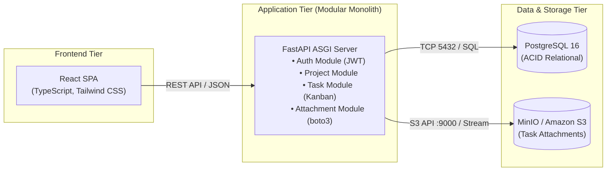

# DeployStack Architecture Documentation

Welcome to the architectural specification for **DeployStack — Three-Tier Web Application with Terraform and AWS**.

This directory contains the complete system architecture, technical design specifications, network topologies, data flow diagrams, and architectural decision records.

---

## Architecture Blueprint Documents

| Document | Purpose |
| :--- | :--- |
| **[System Architecture & Technical Design Document](./system-architecture.md)** | **Master Architectural Specification:** Contains C4 Level 1–3 diagrams, data flow sequences, dual deployment diagrams, module responsibility breakdown, three-tier AWS topology, security group specifications, and FinOps analysis. |
| **[Architecture Decision Records (ADRs)](./decisions/README.md)** | **Decisions & Trade-offs Log:** Formal ADRs documenting modular monolith vs microservices, FastAPI & SQLAlchemy, PostgreSQL, MinIO, Docker Compose, Terraform modules, and the AWS deployment model. |

---

## Architecture Summary at a Glance

### Core Architecture Pillars:
1. **Modular Monolith:** Clean domain boundaries without the distributed systems complexity or microservices latency.
2. **Strict Dual-Plane Strategy:**
   - **Local Runtime Execution Plane:** 100% containerized in Docker Compose for ₹0 local development and instant CI/CD test runs.
   - **Target AWS Cloud Plane:** Fully specified in reusable, production-ready Terraform modules (VPC, Multi-AZ, ALB, EC2 ASG, RDS PostgreSQL, S3, Secrets Manager, NAT Gateways).
3. **Stateless Compute:** Scalable EC2 instances backed by JWT authentication, allowing dynamic autoscaling with zero session loss.
4. **Defense-in-Depth:** Layered security groups chaining ALB -> EC2 -> RDS with zero public IP addresses on application or persistence instances.
