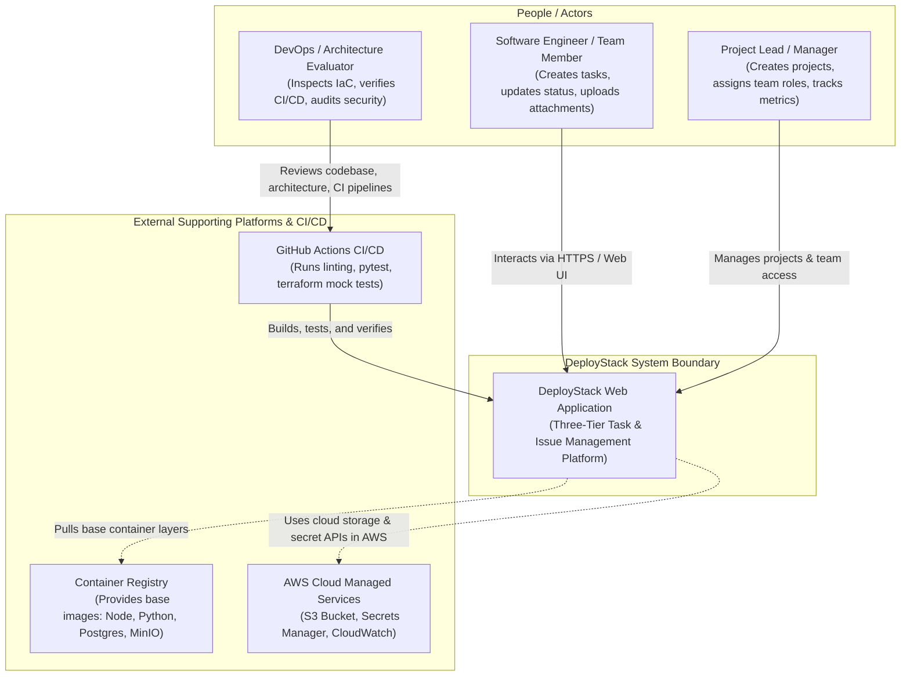
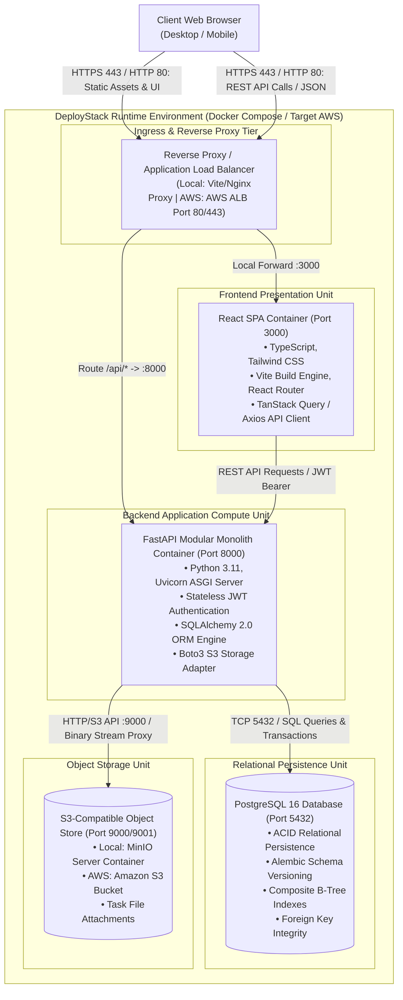
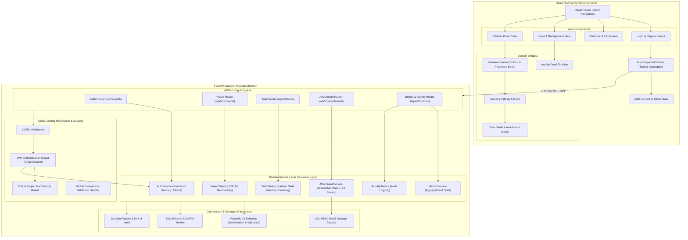
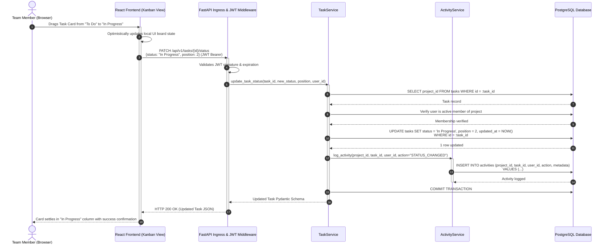
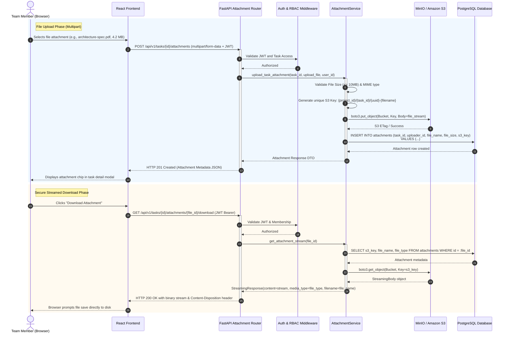
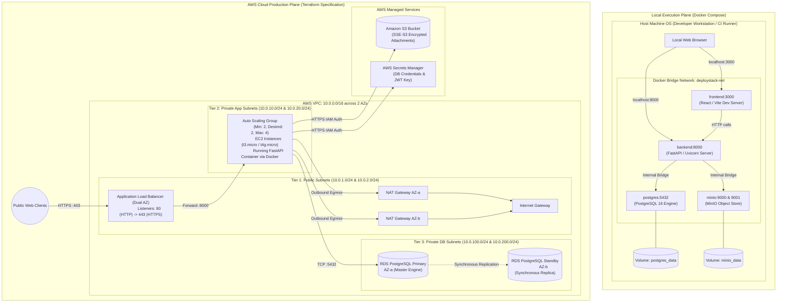
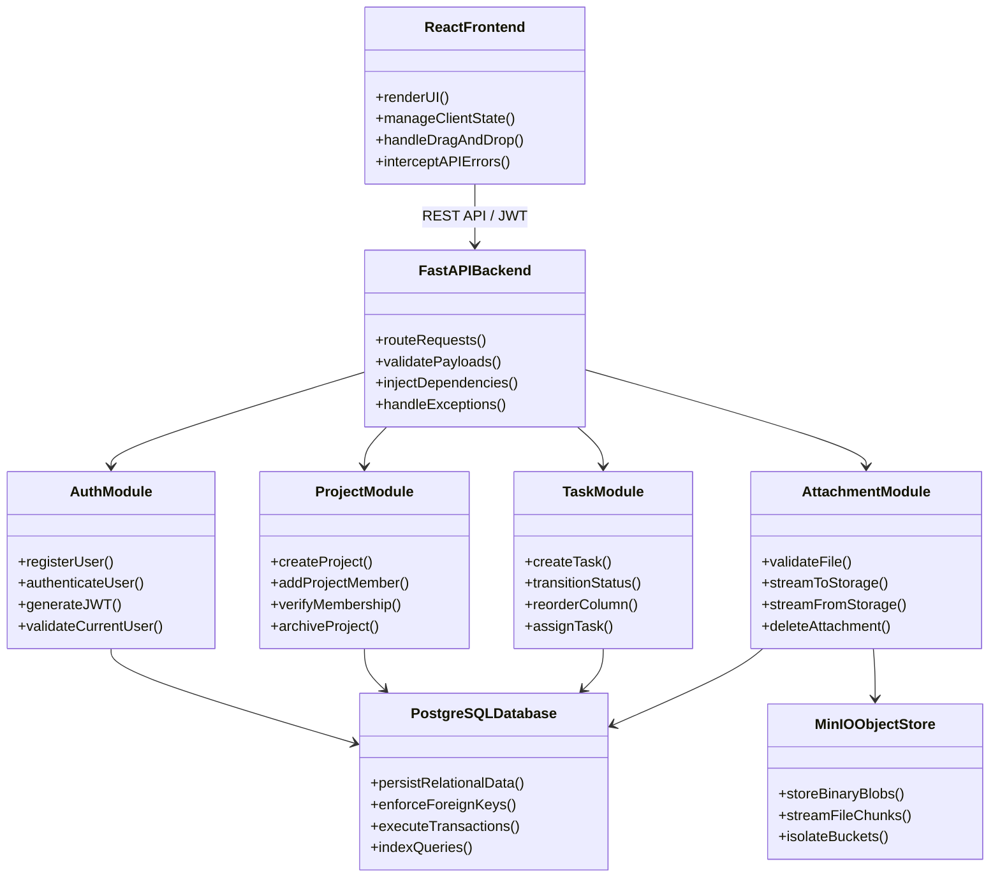
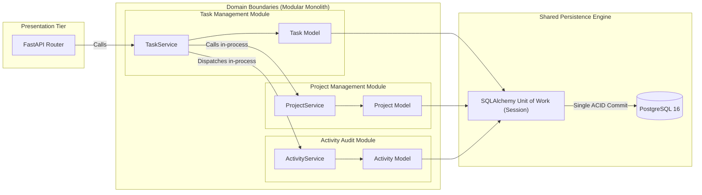
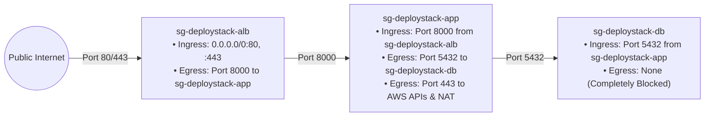
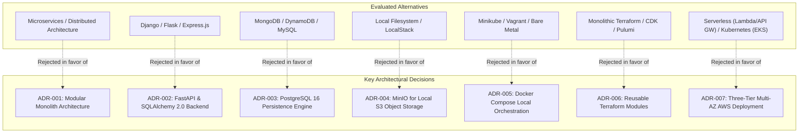

# DeployStack — System Architecture & Technical Design Document

**Document Version:** 2.0.0  
**Status:** Approved Architecture Baseline  
**Date:** 2026-11-12  
**Role:** Principal Software Architect & Cloud Infrastructure Architect  
**Classification:** Technical Architecture Specification  

---

## Executive Summary

DeployStack is a production-grade, three-tier Team Task and Issue Management application engineered to demonstrate modern full-stack development, cloud-native architecture, and Infrastructure as Code (IaC) automation.

The architecture reconciles two fundamental requirements:
1. **Target Cloud Architecture:** An enterprise-ready, three-tier, highly available AWS deployment (VPC, Multi-AZ, ALB, EC2 ASG, RDS PostgreSQL, S3, Secrets Manager, NAT Gateway) defined modularly via Terraform.
2. **Local Runtime Execution Plane:** A 100% portable, zero-cost runtime environment orchestrated via Docker Compose (React, FastAPI, PostgreSQL, MinIO), requiring zero cloud credentials and incurring ₹0 cloud expenditure during development, evaluation, and CI/CD testing.

This document serves as the authoritative blueprint for all application engineering, persistence modeling, cloud networking, and security enforcement across DeployStack.

---

# PART 1: SYSTEM ARCHITECTURE

## 1. System Context Diagram (C4 Level 1)

The System Context diagram establishes the boundary of the DeployStack system, detailing how human actors interact with the application and how the platform integrates with external systems and continuous integration infrastructure.



### Actors & External Entities Description

| Entity | Type | Role & Interaction with DeployStack |
| :--- | :--- | :--- |
| **Team Member** | Human Actor | Interacts with the React Single Page Application (SPA) over HTTPS to view assigned tasks, transition cards across the Kanban board, add comments, and upload/download file attachments. |
| **Project Lead** | Human Actor | Administers workspace projects, invites team members by email, assigns project roles (Owner, Member), archives projects, and analyzes dashboard metrics. |
| **DevOps Evaluator** | Human Actor | Evaluates system architecture, reviews Terraform modules, runs static analysis (`tflint`, `checkov`), and verifies test suites in CI. |
| **GitHub Actions** | External System | Automated CI/CD execution pipeline that triggers on pull requests and pushes, validating code formatting, executing unit/integration tests, and validating Terraform configurations via mock providers. |
| **Container Registry** | External System | Upstream registry providing hardened minimal base images (Python 3.11-slim, Node 20-alpine, PostgreSQL 16-alpine, MinIO). |
| **AWS Managed Services** | Cloud Platform | Target AWS cloud services including Amazon S3 (blob storage), AWS Secrets Manager (credential rotation), and CloudWatch (metrics/logs). |

---

## 2. Container Diagram (C4 Level 2)

The Container diagram illustrates the high-level technical shape of DeployStack, showing the deployable units, the technology stack chosen for each container, data stores, and inter-container communication protocols. DeployStack maintains parity between its local Docker Compose runtime and its AWS cloud target.



### Container Specifications & Protocols

| Container / Unit | Technology | Inbound Protocol | Outbound Protocol | State Model |
| :--- | :--- | :--- | :--- | :--- |
| **Frontend SPA** | React 18/19, TypeScript, Tailwind CSS, Vite | HTTP (Port 3000) | HTTP/REST (Port 8000) | Stateless (Client in-memory state + LocalStorage JWT) |
| **Backend API** | FastAPI, Python 3.11, Uvicorn, Pydantic V2 | HTTP / REST (Port 8000) | TCP/PostgreSQL (5432), HTTP/S3 (9000) | Strictly Stateless (Enables horizontal autoscaling) |
| **Database** | PostgreSQL 16 | TCP / PostgreSQL Wire (Port 5432) | None (Persistence Target) | Stateful (Docker named volume locally; Amazon EBS / Multi-AZ in AWS) |
| **Object Store** | MinIO (Local) / Amazon S3 (AWS) | HTTP / S3 REST API (Port 9000) | None (Persistence Target) | Stateful (Docker named volume locally; AWS S3 managed storage) |

---

## 3. Component Diagram (C4 Level 3)

The Component diagram decomposes the containers into their internal logical building blocks, illustrating the structural design of both the React frontend and the FastAPI modular monolith backend.



---

## 4. Application Data Flow Diagram

This section captures the exact end-to-end data lifecycle across the three tiers for key application workflows.

### 4.1 Workflow A: Task State Transition & Kanban Movement



### 4.2 Workflow B: Secure File Upload & Streaming Download Proxy



---

## 5. Deployment Architecture Diagram

DeployStack supports two complementary deployment representations:
1. **Local Developer Runtime Deployment** (zero-cost execution in Docker Compose).
2. **AWS Production Deployment** (three-tier high-availability IaC specification in Terraform).



---

# PART 2: APPLICATION ARCHITECTURE

## 1. Architectural Paradigm: Modular Monolith vs. Microservices

DeployStack explicitly chooses a **Modular Monolith** architecture over a distributed microservices architecture.

### 1.1 Architectural Rationale

| Evaluation Vector | Modular Monolith (Chosen) | Microservices (Rejected) | Architectural Justification |
| :--- | :--- | :--- | :--- |
| **Operational Complexity** | **Low:** Single deployable unit, single Docker container, unified logging, simple local debugging. | **Extremely High:** Requires service discovery, distributed tracing, Kubernetes or ECS, API gateway routing, and distributed monitoring. | For a team task management tool, microservices introduce accidental complexity without solving domain problems. |
| **Data Consistency & Transactions** | **Strong ACID Guarantees:** Cross-entity operations (e.g., updating a task status and creating an audit activity log) execute in a single ACID database transaction. | **Eventual Consistency:** Requires distributed transactions (Saga pattern), outbox patterns, and message brokers (Kafka/RabbitMQ). | Eliminates data anomalies, duplicate activity entries, and ghost attachments. |
| **Network Latency & Failure Modes** | **Zero RPC Overhead:** Inter-module communication occurs via in-process Python method invocations with zero network latency. | **High RPC Overhead:** Network latency on every inter-service call, circuit breakers, timeout retries, and partial failure modes. | Minimizes latency and eliminates cascade failure vulnerabilities. |
| **Deployment & CI/CD** | **Streamlined:** Single Docker image build, single Pytest test run, deterministic CI pipeline completed in minutes. | **Fragmented:** Multiple container builds, complex version matrix testing, canary deployments across services. | Complies strictly with zero-cost CI resource budgets on GitHub Actions. |
| **Scalability Character** | **Horizontal Monolith Scaling:** The stateless backend scales horizontally across multiple EC2 instances behind an Application Load Balancer. | **Independent Component Scaling:** Each service scales separately. | Compute profiling indicates task management CPU/memory consumption is uniform across modules. Independent scaling is unnecessary. |
| **Domain Evolution** | **Refactor-Friendly:** Domain boundaries are enforced via Python module packaging. If a module ever requires isolation in the future, boundaries are already established. | **Brittle:** Premature decomposition into microservices leads to wrong boundaries and distributed monolith anti-patterns. | Preserves architectural agility and refactoring speed. |

---

## 2. Component & Module Responsibilities



### 2.1 React Frontend
* **Core Responsibilities:**
  * Single Page Application (SPA) presentation built with React, TypeScript, and Tailwind CSS.
  * Client-side routing via React Router with protected route guards checking authentication state.
  * Centralized authentication context (`AuthContext`) managing the JWT access token lifecycle, user profile state, and automatic logout on 401 responses.
  * Optimistic UI updates on Kanban drag-and-drop actions, immediately reflecting state changes while dispatching background API sync requests.
  * Multipart file upload management with client-side file size (< 10MB) and type validation before dispatching requests.
  * User experience features: responsive mobile/desktop layout, toast alerts for API errors, accessible modal dialogs.

### 2.2 FastAPI Backend
* **Core Responsibilities:**
  * Asynchronous, high-performance ASGI application server running on Uvicorn.
  * Ingress routing for all `/api/v1/*` RESTful endpoints.
  * Automatic request and response validation, serialization, and OpenAPI 3.0 documentation generation via Pydantic V2 schemas.
  * Centralized dependency injection (`Depends`) providing scoped database sessions, authenticated user context, and storage adapter instances.
  * Global exception handling translating domain exceptions (e.g., `EntityNotFoundException`, `UnauthorizedException`) into standardized HTTP JSON problem details (`RFC 7807`).
  * Cross-Origin Resource Sharing (CORS) security policy enforcement and health check probes (`/health`).

### 2.3 Authentication Module
* **Core Responsibilities:**
  * User registration and authentication via email and password credentials.
  * Cryptographic password hashing and salt verification using `bcrypt` (work factor >= 12).
  * Issuance of cryptographically signed, stateless JSON Web Tokens (JWT) using HMAC-SHA256 (`HS256`).
  * Token payload structure enforcement: `sub` (user UUID), `email`, `exp` (1-hour expiration timestamp), and `iat`.
  * FastAPI security dependency (`get_current_user`) extracting and verifying the Bearer token on every protected request.
  * Security enforcement: user account activation checks and rate-limiting safeguards on login attempts.

### 2.4 Project Management Module
* **Core Responsibilities:**
  * Project lifecycle management (Creation, Read, Update, Soft Deletion / Archival).
  * Project workspace collaboration: inviting team members by email address.
  * Membership role-based authorization: differentiating `Owner` (full administrative rights, delete project, manage members) from `Member` (collaborative task execution).
  * Project-level scoping: guaranteeing that tasks, boards, and activity logs are strictly partitioned by project ID.
  * Multi-tenancy isolation: verifying that the authenticated user belongs to the project before granting read or write access.

### 2.5 Task Management Module
* **Core Responsibilities:**
  * Task creation, retrieval, updates, and deletion scoped strictly to parent projects.
  * Kanban status state machine management enforcing valid state transitions between `To Do`, `In Progress`, and `Completed`.
  * Column ordering and positioning logic (`position` integer index) ensuring deterministic task ordering on the Kanban board.
  * Task assignment mechanics: assigning/reassigning tasks to verified project members.
  * Priority classification (`Low`, `Medium`, `High`, `Urgent`) and optional due-date tracking.
  * Integration with the activity tracking subsystem to dispatch audit log records on every state transition.

### 2.6 File Attachment Module
* **Core Responsibilities:**
  * Attachment metadata management: recording file name, MIME type, file size in bytes, upload timestamp, and unique object key.
  * Upload validation: enforcing strict file size caps (maximum 10MB per attachment) and MIME type allowlisting.
  * Storage client abstraction: wrapping AWS S3 / MinIO API interactions via a unified `StorageClient` using `boto3`.
  * Streaming upload: streaming uploaded multipart bytes directly to object storage without buffering massive files in container RAM.
  * Streaming download proxy: streaming object bytes from S3/MinIO through FastAPI `StreamingResponse` to client browsers, enforcing JWT authorization and keeping storage credentials 100% private.
  * Cascade deletion: ensuring that when a task or attachment record is deleted, the corresponding object blob is purged from object storage.

### 2.7 PostgreSQL Database Engine
* **Core Responsibilities:**
  * Primary system of record providing full ACID transactional guarantees for all relational entities.
  * Schema definition and database migrations managed via Alembic.
  * Referential integrity enforcement using foreign keys with `ON DELETE CASCADE` rules for dependent task attachments and activities.
  * Performance indexing: composite indexes on `(project_id, status)` for instantaneous Kanban queries, and `(project_id, created_at DESC)` for high-speed activity feeds.
  * Connection pooling and session lifecycle management via SQLAlchemy 2.0.

### 2.8 MinIO Object Storage
* **Core Responsibilities:**
  * Local S3-compatible object storage server providing local runtime parity with Amazon S3.
  * Isolated bucket storage (`deploystack-attachments`) for binary file blobs.
  * Automated bucket initialization during local environment bootstrap.
  * Zero-cost emulation of Amazon S3 API operations (`PutObject`, `GetObject`, `DeleteObject`).
  * Enables identical backend `boto3` driver code to execute seamlessly in both local Docker Compose and production AWS environments without code changes.

---

## 3. Module Boundaries & Inter-Module Communication

To preserve the modular monolith's integrity and prevent tight coupling (the "spaghetti monolith" anti-pattern), all modules communicate via well-defined architectural patterns:



### Communication Rules:
1. **In-Process Method Calls:** Modules invoke public service methods of neighboring modules via Python type-annotated interfaces. No HTTP or message queues are used internally.
2. **Shared Database Session:** Inter-module operations within a single user request participate in the same SQLAlchemy `AsyncSession`/`Session` transaction. If an error occurs during activity logging, the entire transaction rolls back cleanly.
3. **Pydantic DTO Boundaries:** Data returned to callers passes through Pydantic V2 schemas (Data Transfer Objects), preventing leaking raw database models across domain boundaries.
4. **Dependency Injection:** Services and database sessions are injected at request initialization time via FastAPI's `Depends` framework.

---

# PART 3: AWS ARCHITECTURE

DeployStack designs an enterprise-grade, highly available, three-tier cloud infrastructure on Amazon Web Services (AWS) fully declared in modular Terraform.

## 1. Three-Tier AWS Topology Specification

```mermaid
flowchart TB
    subgraph InternetZone ["Public Internet"]
        ClientUser((Client Browser / App))
    end

    subgraph AWSCloud ["AWS Cloud (Region: us-east-1)"]
        subgraph VPC ["DeployStack VPC: 10.0.0.0/16"]
            
            subgraph Tier1_Ingress ["Tier 1: Presentation & Ingress (Public Subnets)"]
                IGW["Internet Gateway (IGW)"]
                ALB["Application Load Balancer (ALB)
                Multi-AZ Ingress (Port 80/443)"]
                
                subgraph PublicSubnets ["Public Subnets (MapPublicIpOnLaunch = true)"]
                    Subnet_Pub_1["Public Subnet AZ-1
                    10.0.1.0/24 (us-east-1a)
                    • ALB Interface
                    • NAT Gateway A"]
                    Subnet_Pub_2["Public Subnet AZ-2
                    10.0.2.0/24 (us-east-1b)
                    • ALB Interface
                    • NAT Gateway B"]
                end
            end

            subgraph Tier2_Compute ["Tier 2: Application Compute (Private App Subnets)"]
                subgraph AppSubnets ["Private App Subnets (No Public IPs)"]
                    Subnet_App_1["Private App Subnet AZ-1
                    10.0.10.0/24 (us-east-1a)
                    • EC2 Instance 1 (FastAPI)"]
                    Subnet_App_2["Private App Subnet AZ-2
                    10.0.20.0/24 (us-east-1b)
                    • EC2 Instance 2 (FastAPI)"]
                end
                
                ASG["EC2 Auto Scaling Group (ASG)
                Launch Template: Amazon Linux 2023 / Docker
                Target Tracking: 60% CPU Utilization"]
            end

            subgraph Tier3_Database ["Tier 3: Persistence Layer (Private DB Subnets)"]
                subgraph DBSubnets ["Private DB Subnets (Strictly Isolated, No Internet Access)"]
                    Subnet_DB_1["Private DB Subnet AZ-1
                    10.0.100.0/24 (us-east-1a)
                    • RDS Primary Instance"]
                    Subnet_DB_2["Private DB Subnet AZ-2
                    10.0.200.0/24 (us-east-1b)
                    • RDS Standby Instance"]
                end

                RDS_Cluster[("Amazon RDS PostgreSQL 16
                Multi-AZ Synchronous Standby
                Allocated: 20GB gp3 (Encrypted)")]
            end
        end

        subgraph ManagedCloudServices ["AWS Managed Cloud Services"]
            S3_Bucket[("Amazon S3 Bucket
            (Private, SSE-S3 Encrypted, BlockPublicAccess)")]
            Secrets_Manager["AWS Secrets Manager
            (Auto-generated DB Passwords & JWT Keys)"]
            CloudWatch["Amazon CloudWatch
            (Container Logs & ALB Alarm Metrics)"]
        end
    end

    ClientUser -->|HTTPS :443| IGW
    IGW --> ALB
    ALB -->|HTTP :8000 (Target Group)| ASG
    ASG -->|TCP :5432| RDS_Cluster
    ASG -->|HTTPS IAM Instance Role| S3_Bucket
    ASG -->|HTTPS IAM Instance Role| Secrets_Manager
    ASG -->|HTTPS Logs| CloudWatch
    Subnet_App_1 -->|Outbound Route 0.0.0.0/0| Subnet_Pub_1
    Subnet_App_2 -->|Outbound Route 0.0.0.0/0| Subnet_Pub_2
```

### 1.1 VPC & Subnet IP Addressing Plan

The VPC allocates non-overlapping `/24` subnets within the `10.0.0.0/16` CIDR block across two Availability Zones (`us-east-1a` and `us-east-1b`):

| Subnet Identifier | Availability Zone | CIDR Block | Usable IPs | Route Table Target | Purpose & Placed Resources |
| :--- | :---: | :---: | :---: | :--- | :--- |
| **`public-subnet-1`** | `us-east-1a` | `10.0.1.0/24` | 251 | `0.0.0.0/0` -> `IGW` | ALB Node 1, NAT Gateway A |
| **`public-subnet-2`** | `us-east-1b` | `10.0.2.0/24` | 251 | `0.0.0.0/0` -> `IGW` | ALB Node 2, NAT Gateway B |
| **`private-app-subnet-1`**| `us-east-1a` | `10.0.10.0/24`| 251 | `0.0.0.0/0` -> `NAT-GW-A` | EC2 ASG Instances (App Tier) |
| **`private-app-subnet-2`**| `us-east-1b` | `10.0.20.0/24`| 251 | `0.0.0.0/0` -> `NAT-GW-B` | EC2 ASG Instances (App Tier) |
| **`private-db-subnet-1`** | `us-east-1a` | `10.0.100.0/24`| 251 | Local VPC Route Only | RDS PostgreSQL Primary Instance |
| **`private-db-subnet-2`** | `us-east-1b` | `10.0.200.0/24`| 251 | Local VPC Route Only | RDS PostgreSQL Standby Replica |

---

## 2. Network Traffic Flows

### 2.1 Ingress Traffic Flow (Client to Application)
1. **DNS Resolution & Entry:** The client browser issues an HTTPS request to `https://app.deploystack.io`. AWS Route 53 resolves the domain to the public IP addresses of the Application Load Balancer across both AZs.
2. **Ingress at Public Subnets:** Traffic enters the VPC through the **Internet Gateway (IGW)** and arrives at the ALB interfaces in `10.0.1.0/24` and `10.0.2.0/24`.
3. **TLS Termination & Health Routing:** The ALB terminates TLS using an AWS Certificate Manager (ACM) certificate. The ALB evaluates path rules:
   * `/api/*` and `/health` requests are balanced across healthy target group instances on port 8000 using round-robin distribution.
4. **Forwarding to Private Compute:** Traffic traverses from the public subnets into the **Private Application Subnets** (`10.0.10.0/24`, `10.0.20.0/24`) over HTTP port 8000 directly to the EC2 instances. At no point is the application compute instance exposed to public IP space.

### 2.2 Persistence & Managed Service Traffic Flow
1. **Database Access:** When FastAPI executes database queries, connections originate from the private app instances (`10.0.10.x`, `10.0.20.x`) and target the RDS PostgreSQL primary endpoint in the **Private Database Subnets** (`10.0.100.x`, `10.0.200.x`) over TCP port 5432. Traffic remains completely internal to the VPC.
2. **Object Storage Access (S3):** Attachment uploads/downloads travel from the EC2 instance to Amazon S3 over HTTPS (Port 443). The instance authenticates automatically using temporary credentials provided by the EC2 IAM Instance Profile. In production, an S3 Gateway VPC Endpoint (`com.amazonaws.us-east-1.s3`) routes traffic directly across AWS private networking without traversing the NAT Gateway.
3. **Secrets Retrieval:** During instance initialization (User Data script), the instance queries AWS Secrets Manager over HTTPS via IAM instance profile credentials to retrieve database passwords and JWT signing keys.

### 2.3 Egress Traffic Flow (Outbound from Application)
1. **Private Subnet Outbound:** EC2 instances in private subnets require egress access to pull Docker base images, install security patches, and interact with AWS API endpoints.
2. **NAT Gateway Routing:** Outbound packets with destination `0.0.0.0/0` are directed by the private route table to the **NAT Gateway** located in the corresponding public subnet (`NAT-GW-A` in AZ-1, `NAT-GW-B` in AZ-2).
3. **Internet Gateway Egress:** The NAT Gateway translates the private source IP to its allocated Elastic IP (EIP) and forwards traffic through the **Internet Gateway** to the public internet. Responses are translated back and returned. Outside hosts cannot initiate connections back to private instances.

---

## 3. Security Group Relationships & Defense-in-Depth

The security architecture enforces the **Principle of Least Privilege** using layered, chained Security Groups. Firewalls reference source Security Group IDs rather than CIDR blocks wherever possible to eliminate accidental network exposure:



### Security Group Rule Specifications

| Security Group | Ingress Rules | Egress Rules | Architectural Intent |
| :--- | :--- | :--- | :--- |
| **`sg-deploystack-alb`** (ALB Tier) | • `TCP 80` from `0.0.0.0/0`<br/>• `TCP 443` from `0.0.0.0/0` | • `TCP 8000` to `sg-deploystack-app` | Allows public web traffic to the ALB. Egress is restricted strictly to backend application ports. |
| **`sg-deploystack-app`** (Compute Tier)| • `TCP 8000` from `sg-deploystack-alb` | • `TCP 5432` to `sg-deploystack-db`<br/>• `TCP 443` to `0.0.0.0/0` (APIs/NAT) | Blocks all public ingress. Accepts traffic only from the ALB. Restricts DB egress exclusively to the database security group. |
| **`sg-deploystack-db`** (Database Tier) | • `TCP 5432` from `sg-deploystack-app` | • None (All egress explicitly denied) | Strict persistence isolation. PostgreSQL only accepts connections originating from authenticated application instances. |

---

## 4. Public versus Private Resource Placement

The placement strategy strictly confines the blast radius of any potential compromise:

```
[ Public Zone (Untrusted / Entry) ]
  ├── Internet Gateway (VPC Edge)
  ├── Application Load Balancer (Public Subnets, Public IPs)
  └── NAT Gateways (Public Subnets, Elastic Public IPs)
-------------------------------------------------------------------------
[ Private Zone (Trusted / Application Tier) ]
  ├── EC2 Auto Scaling Instances (Private Subnets, NO Public IPs)
  ├── Docker Engine & FastAPI Modular Monolith
  └── IAM Instance Profile (Least-privilege role credentials)
-------------------------------------------------------------------------
[ Isolated Zone (Restricted / Data Tier) ]
  ├── Amazon RDS PostgreSQL Multi-AZ (Private DB Subnets, NO Public IPs, NO Internet Route)
  ├── AWS Secrets Manager (KMS-encrypted at rest)
  └── Amazon S3 Bucket (Private, S3 Block Public Access enabled)
```

1. **Zero Public IPs on Compute & Persistence:** Neither EC2 instances nor RDS instances possess public IPv4 addresses. Even if an internet-wide scan targets the VPC's subnet CIDRs, private instances cannot receive inbound internet packets.
2. **Database Isolation:** Private DB Subnets have route tables with no target for `0.0.0.0/0` (no IGW, no NAT). The database cannot reach the internet, and the internet cannot reach the database.
3. **No Direct SSH / Bastion:** Administration is conducted securely via **AWS Systems Manager (SSM) Session Manager**. This eliminates open port 22 SSH keys, bastion hosts, and exposed management ports.

---

## 5. High Availability & Resilience Considerations

| Dimension | Architectural Implementation | Failure Scenario Handled |
| :--- | :--- | :--- |
| **Zone Outage (AZ Failure)** | Infrastructure spans two Availability Zones (`us-east-1a` and `us-east-1b`). ALB routes around failed AZs automatically. | Loss of an entire AWS data center does not disrupt service. |
| **Compute Node Failure** | EC2 Auto Scaling Group maintains minimum healthy instance count (`min=2`). ALB target group runs active health checks (`GET /health` every 15s). | If an instance crashes or becomes unresponsive, ALB shifts traffic immediately; ASG terminates the failed node and launches a fresh replacement. |
| **Database Failure** | Amazon RDS Multi-AZ synchronously replicates data from Primary (AZ-a) to Standby (AZ-b). | In the event of primary hardware or storage failure, RDS performs an automatic DNS failover to the standby replica within 60–120 seconds with zero data loss. |
| **Blob Storage Resilience** | Amazon S3 provides 99.999999999% (11 9s) of data durability by redundantly storing objects across multiple facilities within the region. | Protects attachments against multi-facility hardware corruption and physical device loss. |
| **Stateless Compute Tier** | Session state is stored in client-side JWTs; backend holds no session state in local memory. | Instances can be recycled, scaled out, or terminated without interrupting active user workflows. |

---

## 6. Cost Implications & FinOps Analysis

DeployStack is engineered with a strict dual-perspective cost model:
* **Production AWS Deployment:** Fully cost-modeled for real-world enterprise capacity.
* **Development / Evaluation:** Enforced at **₹0 / $0** via local Docker Compose and Terraform parameterization.

### 6.1 Estimated Monthly AWS Production Cost (us-east-1 Baseline)

| AWS Service | Specification & Tier | Monthly Cost (USD) | Cost Optimization Strategies |
| :--- | :--- | :---: | :--- |
| **NAT Gateways (2x)** | 1 per AZ for high availability (\$0.045/hr + \$0.045/GB) | **\$65.00** | High cost driver. In `dev` environment, NAT Gateways can be parameterized to 1 or disabled entirely (`enable_nat_gateway = false`). |
| **Application Load Balancer** | 1 ALB across 2 AZs (\$0.0225/hr + LCU charges) | **\$18.50** | Scalable ingress point. Essential for TLS termination and multi-AZ routing. |
| **EC2 Compute (2x)** | 2x `t3.micro` or `t4g.micro` (Graviton2) On-Demand | **\$14.80** | Can utilize AWS Free Tier (750 hours/mo `t3.micro`) or AWS Graviton `t4g.micro` for ~20% additional savings. |
| **RDS PostgreSQL** | `db.t4g.micro` Multi-AZ (20 GB gp3 storage) | **\$29.00** | For non-production staging, Single-AZ (`db.t4g.micro`) reduces cost to ~\$14.50/mo. Free tier eligible for 750 hrs Single-AZ `db.t3.micro`. |
| **Amazon S3 & Data Transfer** | 10 GB Standard Storage + 5,000 PUT/GET requests | **\$0.50** | S3 Intelligent-Tiering and lifecycle rules to transition old attachments to Glacier. |
| **AWS Secrets Manager** | 2 secrets (DB Master Credentials, JWT Secret Key) | **\$0.80** | \$0.40 per secret per month. Negligible. |
| **Estimated Total Monthly** | **Full Multi-AZ Production Topology** | **~\$128.60 / mo** | |

### 6.2 FinOps Controls & Zero-Cost MVP Safeguards
1. **Local-First Zero-Cost Guarantee:** Development, feature verification, and pull request testing run locally in Docker Compose at ₹0 cost.
2. **Terraform Parameterization:** The Terraform `networking` module includes a boolean variable `enable_nat_gateway = false` in development environments to eliminate the \$65/month NAT Gateway charge.
3. **No Accidental Cloud Spend:** CI/CD runs Terraform in mock mode (`terraform test` with `mock_provider "aws"`). `terraform apply` is strictly prohibited in automated pipelines without explicit administrative approval gates.

---

# PART 4: ARCHITECTURAL DECISIONS

DeployStack documents all foundational engineering trade-offs using formal **Architecture Decision Records (ADRs)** located in `docs/architecture/decisions/`.

## 1. Summary of Architectural Decisions & Evaluated Alternatives



| Decision Record | Topic | Chosen Solution | Rejected Alternatives | Primary Architectural Driver |
| :--- | :--- | :--- | :--- | :--- |
| **[ADR-001](./decisions/ADR-001-modular-monolith-vs-microservices.md)** | System Architectural Pattern | **Modular Monolith** | Microservices Architecture, Distributed Services | Avoid distributed transaction complexity, network latency, and operational overhead while maintaining strict domain boundaries. |
| **[ADR-002](./decisions/ADR-002-fastapi-and-sqlalchemy.md)** | Backend Framework & ORM | **FastAPI + SQLAlchemy 2.0 + Pydantic V2** | Django REST Framework, Flask, Express.js (Node.js) | High-performance async ASGI runtime, native OpenAPI schema generation, strict type safety, modern Python typing. |
| **[ADR-003](./decisions/ADR-003-postgresql-database.md)** | Relational Persistence Engine | **PostgreSQL 16** | MongoDB, Amazon DynamoDB, MySQL | Relational integrity, ACID compliance, composite indexing for Kanban boards, rich JSONB support for activity audit logs. |
| **[ADR-004](./decisions/ADR-004-minio-local-object-storage.md)** | Local Object Storage Abstraction | **MinIO (S3-Compatible) + Streaming Proxy** | Direct Local Filesystem, LocalStack | Identical AWS S3 API compatibility using `boto3`, zero host DNS configuration issues, zero cloud cost in local dev. |
| **[ADR-005](./decisions/ADR-005-docker-compose-orchestration.md)** | Local Multi-Container Runtime | **Docker Compose** | Minikube (Kubernetes), Podman Pods, Bare Metal Localhost | Ubiquitous developer tooling, lightweight resource footprint, declarative multi-container bridge networking, seamless CI testing. |
| **[ADR-006](./decisions/ADR-006-terraform-modules.md)** | Infrastructure as Code Architecture | **Modular Terraform (Networking, Compute, DB, S3)** | Monolithic `main.tf`, AWS CDK, Pulumi | Separation of concerns, reusability across dev/prod environments, enterprise IaC best practices, mock testing compatibility. |
| **[ADR-007](./decisions/ADR-007-aws-three-tier-deployment-model.md)** | Target Cloud Hosting Topology | **Three-Tier Multi-AZ VPC (ALB + EC2 ASG + RDS)** | AWS Lambda Serverless, Amazon EKS (Kubernetes), Elastic Beanstalk | Industry standard cloud architecture, clear tier isolation, strict defense-in-depth security groups, high availability without container orchestration bloat. |

---

## 2. Directory Structure of Architecture Documentation

The complete architectural package is stored under `docs/architecture/`:

```text
docs/architecture/
├── README.md                                  # Architectural Overview & Navigation Index
├── system-architecture.md                     # Master Technical Design Document (This File)
└── decisions/                                 # Architecture Decision Records (ADRs)
    ├── README.md                              # ADR Catalog & Index
    ├── ADR-001-modular-monolith-vs-microservices.md
    ├── ADR-002-fastapi-and-sqlalchemy.md
    ├── ADR-003-postgresql-database.md
    ├── ADR-004-minio-local-object-storage.md
    ├── ADR-005-docker-compose-orchestration.md
    ├── ADR-006-terraform-modules.md
    ├── ADR-007-aws-three-tier-deployment-model.md
    ├── ADR-008-stateless-jwt-authentication.md
    ├── ADR-009-terraform-mock-provider-testing.md
    └── ADR-010-zero-cost-local-first-execution.md
```

---

## 3. Review & Sign-Off Checklist

- [x] **Part 1:** System Context, Container, Component, Application Data Flow, and Deployment Architecture diagrams created with high-fidelity Mermaid syntax.
- [x] **Part 2:** Application responsibilities explicitly defined for React, FastAPI, Auth, Projects, Tasks, Attachments, PostgreSQL, and MinIO. Modular monolith selected and microservices rejected with comprehensive technical reasoning.
- [x] **Part 3:** Three-tier AWS architecture designed spanning VPC, 2 AZs, Public, App, and DB subnets, ALB, ASG, RDS, S3, Secrets Manager, IGW, and NAT Gateways. Traffic flows, security groups, public vs. private placement, HA, and FinOps costs fully detailed.
- [x] **Part 4:** 7 dedicated ADRs covering all requested decisions, alternatives, and trade-offs, augmented by supplementary records on authentication, mock testing, and zero-cost constraints.
