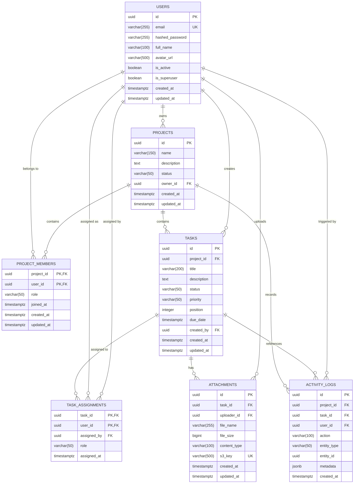

# DeployStack — Relational Database Schema & Data Architecture Specification

**Document Version:** 1.0.0  
**Status:** Approved Architecture Specification  
**Database Engine:** PostgreSQL 16  
**ORM Target:** SQLAlchemy 2.0 (Python / FastAPI)  
**Migration Tool:** Alembic  
**Date:** 2026-11-13  
**Authors:** Senior Software Architect & Database Architect  

---

## Executive Summary

This document specifies the authoritative relational database schema for **DeployStack**, a Three-Tier Team Task and Issue Management Web Application. The persistence layer is designed to run on **PostgreSQL 16** (utilizing Amazon RDS PostgreSQL Multi-AZ in the target production cloud architecture, and official PostgreSQL Docker containers for local zero-cost development).

The design emphasizes:
1. **Third Normal Form (3NF) relational purity** to eliminate update and deletion anomalies.
2. **Strict referential integrity** enforced through foreign keys, check constraints, and declarative cascade behavior.
3. **Optimized query indexing** supporting sub-150ms P95 latency for high-concurrency Kanban operations, multi-tenant workspace isolation, and activity audit streams.
4. **Decoupled domain relationships** cleanly separating workspace access governance (`project_members`) from granular work allocation (`task_assignments`).
5. **Robust auditability** via append-only activity logging and automated UTC timestamp tracking.

---

## 1. Architectural Analysis: Project Membership vs. Task Assignment

A fundamental domain modeling decision is whether project membership and task assignment should be unified into a single relationship or modeled through independent relational structures.

### 1.1 Structural Comparison

| Dimension | Option A: Unified Relationship (Tasks link to `project_members`) | Option B: Separate Decoupled Relationships (`project_members` & `task_assignments`) — **SELECTED** |
| :--- | :--- | :--- |
| **Domain Scope** | Conflates workspace tenant access with individual task accountability. | Enforces strict separation of concerns between security boundary and work execution. |
| **Cardinality** | Typically restricts tasks to a single member row ($1:N$) or requires complex multi-column keys. | Cleanly supports multiple assignees per task ($M:N$) as well as single primary assignee patterns. |
| **Foreign Key Complexity** | Requires composite foreign keys `(project_id, user_id)` on `tasks`, leaking workspace structure into task models. | Direct, clean foreign keys `tasks.project_id -> projects.id` and `task_assignments.task_id -> tasks.id`. |
| **Lifecycle & Churn** | Project membership is stable and long-lived (months/years). Tasks churn rapidly (hours/days). Coupling them causes cascading locking hazards. | Assignments can be freely created, updated, and purged without touching membership tables or locking workspace metadata. |
| **Membership Revocation** | If a member is removed, either all tasks assigned to them must be modified simultaneously or referential integrity breaks. | When a member leaves a project, their `task_assignments` are cleanly cascade-deleted without modifying task definitions or historical activity logs. |
| **Metadata Isolation** | Membership metadata (`role`, `invited_at`) is polluted if task assignment metadata (`assigned_by`, `assigned_at`) is combined. | Each join table encapsulates strictly relevant domain attributes. |

### 1.2 Decision & Rationale

**Decision:** We model **Project Membership** (`project_members`) and **Task Assignment** (`task_assignments`) through **separate, dedicated relational entities**.

#### Architectural Justifications:
1. **Separation of Authorization Boundary from Work Delegation:**  
   `project_members` establishes the **tenant boundary**. A user in `project_members` is authorized to view the project workspace and collaborate within it. In contrast, `task_assignments` represents **operational delegation** (who is actively responsible for delivering an issue). A user may belong to a project for months without having an active task assigned; conversely, when a user is unassigned from a task, their project membership remains intact.
2. **Support for Collaborative Task Assignment ($M:N$):**  
   Modern issue tracking requires flexible work patterns (e.g., pair programming, co-assignees, QA reviewers). A dedicated `task_assignments` junction table natively models $M:N$ relationships without schema alterations, denormalized JSON arrays, or awkward comma-separated foreign keys.
3. **Integrity Invariant Enforcement:**  
   A critical business invariant states: *A user can only be assigned to a task if that user is currently an active member of the task's parent project.*  
   Decoupling the tables allows this constraint to be cleanly enforced at the application service boundary within an ACID transaction, and verified at the database level via triggers or composite foreign keys if desired.
4. **Independent Cascade Semantics:**  
   If a user is removed from a project, database cascade triggers or application logic purge their active `task_assignments` within that project's tasks without altering the tasks themselves (preventing accidental task deletion or dangling references).

---

## 2. Entity-Relationship (ER) Diagram



---

## 3. Detailed Entity & Table Specifications

### 3.1 `users` Table

Stores user account credentials, profile data, and platform access state.

| Column | Data Type | Nullable | Default | Constraints & Rules | Description |
| :--- | :--- | :--- | :--- | :--- | :--- |
| `id` | `UUID` | No | `gen_random_uuid()` | `PRIMARY KEY` | Globally unique identifier (UUID v4) |
| `email` | `VARCHAR(255)` | No | — | `UNIQUE`, Lowercase normalized | User email address used for login |
| `hashed_password` | `VARCHAR(255)` | No | — | Bcrypt hash format (`$2b$12$...`) | Cryptographic salt and password hash |
| `full_name` | `VARCHAR(100)` | No | — | Min length 1, max length 100 | User display name |
| `avatar_url` | `VARCHAR(500)` | Yes | `NULL` | Valid URL syntax if present | Profile picture URL |
| `is_active` | `BOOLEAN` | No | `TRUE` | — | Account status; inactive users cannot authenticate |
| `is_superuser` | `BOOLEAN` | No | `FALSE` | — | Platform administrative privilege flag |
| `created_at` | `TIMESTAMPTZ`| No | `NOW()` | ISO 8601 UTC | Timestamp of account registration |
| `updated_at` | `TIMESTAMPTZ`| No | `NOW()` | ISO 8601 UTC | Timestamp of latest profile modification |

#### Constraints & Indexes:
- **PK:** `pk_users` on `(id)`
- **Unique:** `uq_users_email` on `(email)`
- **Index:** `idx_users_email_lower` on `(LOWER(email))` — Supports case-insensitive email authentication.
- **Index:** `idx_users_is_active` on `(is_active)` — Fast filter for active accounts.

---

### 3.2 `projects` Table

Top-level collaborative workspace boundary containing tasks, members, and activity history.

| Column | Data Type | Nullable | Default | Constraints & Rules | Description |
| :--- | :--- | :--- | :--- | :--- | :--- |
| `id` | `UUID` | No | `gen_random_uuid()` | `PRIMARY KEY` | Globally unique project identifier |
| `name` | `VARCHAR(150)` | No | — | Min length 1, max 150 | Project title / workspace name |
| `description` | `TEXT` | Yes | `NULL` | — | Detailed project overview and objectives |
| `status` | `VARCHAR(50)` | No | `'active'` | `CHECK (status IN ('active', 'archived', 'completed'))` | Workspace lifecycle state |
| `owner_id` | `UUID` | No | — | `REFERENCES users(id) ON DELETE CASCADE` | Creator and primary administrator of the project |
| `created_at` | `TIMESTAMPTZ`| No | `NOW()` | ISO 8601 UTC | Project creation timestamp |
| `updated_at` | `TIMESTAMPTZ`| No | `NOW()` | ISO 8601 UTC | Timestamp of latest metadata update |

#### Constraints & Indexes:
- **PK:** `pk_projects` on `(id)`
- **FK:** `fk_projects_owner_id` -> `users(id)` with `ON DELETE CASCADE`
- **Check:** `ck_projects_status` validates `status IN ('active', 'archived', 'completed')`
- **Index:** `idx_projects_owner_id` on `(owner_id)` — Quick retrieval of projects created by a user.
- **Index:** `idx_projects_status` on `(status)` — Enables fast filtering of active vs archived workspaces.
- **Index:** `idx_projects_created_at` on `(created_at DESC)` — Chronological sorting for project listings.

---

### 3.3 `project_members` Table

Many-to-Many junction table modeling user access to projects and workspace roles.

| Column | Data Type | Nullable | Default | Constraints & Rules | Description |
| :--- | :--- | :--- | :--- | :--- | :--- |
| `project_id` | `UUID` | No | — | `REFERENCES projects(id) ON DELETE CASCADE` | Parent project identifier |
| `user_id` | `UUID` | No | — | `REFERENCES users(id) ON DELETE CASCADE` | Associated user identifier |
| `role` | `VARCHAR(50)` | No | `'member'` | `CHECK (role IN ('owner', 'admin', 'member', 'viewer'))` | Project-scoped authorization role |
| `joined_at` | `TIMESTAMPTZ`| No | `NOW()` | ISO 8601 UTC | Timestamp when membership was accepted |
| `created_at` | `TIMESTAMPTZ`| No | `NOW()` | ISO 8601 UTC | Record creation timestamp |
| `updated_at` | `TIMESTAMPTZ`| No | `NOW()` | ISO 8601 UTC | Timestamp of latest role update |

#### Constraints & Indexes:
- **PK:** `pk_project_members` composite primary key on `(project_id, user_id)` — Guarantees a user cannot be added twice to the same project.
- **FK 1:** `fk_pm_project_id` -> `projects(id)` with `ON DELETE CASCADE`
- **FK 2:** `fk_pm_user_id` -> `users(id)` with `ON DELETE CASCADE`
- **Check:** `ck_pm_role` validates `role IN ('owner', 'admin', 'member', 'viewer')`
- **Index:** `idx_pm_user_id` on `(user_id)` — Fast lookup of all projects a given user is enrolled in.
- **Index:** `idx_pm_project_role` on `(project_id, role)` — Fast filtering of project administrators or members.

---

### 3.4 `tasks` Table

Represents actionable work items organized on the Kanban board.

| Column | Data Type | Nullable | Default | Constraints & Rules | Description |
| :--- | :--- | :--- | :--- | :--- | :--- |
| `id` | `UUID` | No | `gen_random_uuid()` | `PRIMARY KEY` | Globally unique task identifier |
| `project_id` | `UUID` | No | — | `REFERENCES projects(id) ON DELETE CASCADE` | Parent project boundary |
| `title` | `VARCHAR(200)` | No | — | Min length 1, max 200 | Task headline / issue summary |
| `description` | `TEXT` | Yes | `NULL` | — | Markdown-enabled issue description |
| `status` | `VARCHAR(50)` | No | `'todo'` | `CHECK (status IN ('todo', 'in_progress', 'completed'))` | Kanban column classification |
| `priority` | `VARCHAR(50)` | No | `'medium'` | `CHECK (priority IN ('low', 'medium', 'high', 'urgent'))` | Urgency / impact rating |
| `position` | `INTEGER` | No | `0` | `CHECK (position >= 0)` | Deterministic order index within a Kanban column |
| `due_date` | `TIMESTAMPTZ`| Yes | `NULL` | ISO 8601 UTC | Optional target completion deadline |
| `created_by` | `UUID` | No | — | `REFERENCES users(id) ON DELETE RESTRICT` | User who originally authored the task |
| `created_at` | `TIMESTAMPTZ`| No | `NOW()` | ISO 8601 UTC | Task creation timestamp |
| `updated_at` | `TIMESTAMPTZ`| No | `NOW()` | ISO 8601 UTC | Timestamp of latest task modification |

#### Constraints & Indexes:
- **PK:** `pk_tasks` on `(id)`
- **FK 1:** `fk_tasks_project_id` -> `projects(id)` with `ON DELETE CASCADE`
- **FK 2:** `fk_tasks_created_by` -> `users(id)` with `ON DELETE RESTRICT` (prevents deleting user accounts while task audit histories exist)
- **Check 1:** `ck_tasks_status` validates `status IN ('todo', 'in_progress', 'completed')`
- **Check 2:** `ck_tasks_priority` validates `priority IN ('low', 'medium', 'high', 'urgent')`
- **Check 3:** `ck_tasks_position` validates `position >= 0`
- **Index:** `idx_tasks_kanban` composite index on `(project_id, status, position)` — **Critical high-performance index** powering zero-latency Kanban column queries and drag-and-drop reordering.
- **Index:** `idx_tasks_project_created` on `(project_id, created_at DESC)` — Fast chronological task feed.
- **Index:** `idx_tasks_due_date` on `(due_date)` WHERE `due_date IS NOT NULL` — Partial index powering dashboard overdue and upcoming deadline queries.
- **Index:** `idx_tasks_created_by` on `(created_by)` — Fast lookup of tasks authored by a user.

---

### 3.5 `task_assignments` Table

Decoupled junction entity linking tasks to designated user assignees with assignment metadata.

| Column | Data Type | Nullable | Default | Constraints & Rules | Description |
| :--- | :--- | :--- | :--- | :--- | :--- |
| `task_id` | `UUID` | No | — | `REFERENCES tasks(id) ON DELETE CASCADE` | Associated task identifier |
| `user_id` | `UUID` | No | — | `REFERENCES users(id) ON DELETE CASCADE` | User assigned to work on the task |
| `assigned_by`| `UUID` | Yes | `NULL` | `REFERENCES users(id) ON DELETE SET NULL` | User who initiated the assignment |
| `role` | `VARCHAR(50)` | No | `'assignee'` | `CHECK (role IN ('assignee', 'reviewer', 'watcher'))`| Assignment responsibility type |
| `assigned_at`| `TIMESTAMPTZ`| No | `NOW()` | ISO 8601 UTC | Timestamp when assignment was recorded |

#### Constraints & Indexes:
- **PK:** `pk_task_assignments` composite primary key on `(task_id, user_id)` — Prevents duplicate assignment of the same user to the same task.
- **FK 1:** `fk_ta_task_id` -> `tasks(id)` with `ON DELETE CASCADE`
- **FK 2:** `fk_ta_user_id` -> `users(id)` with `ON DELETE CASCADE`
- **FK 3:** `fk_ta_assigned_by` -> `users(id)` with `ON DELETE SET NULL`
- **Check:** `ck_ta_role` validates `role IN ('assignee', 'reviewer', 'watcher')`
- **Index:** `idx_ta_user_id` on `(user_id)` — **Crucial performance index** powering user dashboard queries (*"My Tasks"* across all projects).
- **Index:** `idx_ta_assigned_by` on `(assigned_by)` — Fast tracking of assignments initiated by a manager.

---

### 3.6 `attachments` Table

Records metadata for binary file uploads stored in MinIO / Amazon S3.

| Column | Data Type | Nullable | Default | Constraints & Rules | Description |
| :--- | :--- | :--- | :--- | :--- | :--- |
| `id` | `UUID` | No | `gen_random_uuid()` | `PRIMARY KEY` | Globally unique attachment identifier |
| `task_id` | `UUID` | No | — | `REFERENCES tasks(id) ON DELETE CASCADE` | Associated task |
| `uploader_id`| `UUID` | No | — | `REFERENCES users(id) ON DELETE RESTRICT`| User who uploaded the binary blob |
| `file_name` | `VARCHAR(255)` | No | — | Sanitized original filename | Original uploaded filename |
| `file_size` | `BIGINT` | No | — | `CHECK (file_size > 0 AND file_size <= 10485760)` | File size in bytes (max 10MB) |
| `content_type`| `VARCHAR(100)`| No | — | Valid MIME type string | Media type (e.g. `image/png`, `application/pdf`) |
| `s3_key` | `VARCHAR(500)` | No | — | `UNIQUE` | Unique storage object key in S3 / MinIO bucket |
| `created_at` | `TIMESTAMPTZ`| No | `NOW()` | ISO 8601 UTC | File upload timestamp |
| `updated_at` | `TIMESTAMPTZ`| No | `NOW()` | ISO 8601 UTC | Metadata update timestamp |

#### S3 Key Conventions:
Format: `attachments/{project_id}/{task_id}/{uuid}-{sanitized_filename}`  
Example: `attachments/4b5b7192-3a3a-4464-9be8-f9b6e828d844/8cf1cf14-1180-4965-b77c-a49cf97c0338/d6f78f8c-mockup.png`

#### Constraints & Indexes:
- **PK:** `pk_attachments` on `(id)`
- **FK 1:** `fk_attachments_task_id` -> `tasks(id)` with `ON DELETE CASCADE`
- **FK 2:** `fk_attachments_uploader_id` -> `users(id)` with `ON DELETE RESTRICT`
- **Unique:** `uq_attachments_s3_key` on `(s3_key)`
- **Check:** `ck_attachments_file_size` validates `file_size > 0 AND file_size <= 10485760` (10MB maximum limit)
- **Index:** `idx_attachments_task_id` on `(task_id)` — Quick retrieval of all attachments attached to a task card.
- **Index:** `idx_attachments_uploader_id` on `(uploader_id)` — Tracks storage consumption per user.

---

### 3.7 `activity_logs` Table

Append-only audit trail capturing state changes, status transitions, and user actions across projects and tasks.

| Column | Data Type | Nullable | Default | Constraints & Rules | Description |
| :--- | :--- | :--- | :--- | :--- | :--- |
| `id` | `UUID` | No | `gen_random_uuid()` | `PRIMARY KEY` | Globally unique audit record identifier |
| `project_id` | `UUID` | No | — | `REFERENCES projects(id) ON DELETE CASCADE` | Scoping project boundary |
| `task_id` | `UUID` | Yes | `NULL` | `REFERENCES tasks(id) ON DELETE SET NULL` | Optional task reference |
| `user_id` | `UUID` | Yes | `NULL` | `REFERENCES users(id) ON DELETE SET NULL` | User who performed the operation |
| `action` | `VARCHAR(100)` | No | — | Standardized action enum token | Action type (e.g. `TASK_STATUS_CHANGED`) |
| `entity_type`| `VARCHAR(50)` | No | — | `CHECK (entity_type IN ('project', 'task', 'member', 'assignment', 'attachment'))` | Entity category affected |
| `entity_id` | `UUID` | Yes | `NULL` | — | Identifier of affected entity |
| `metadata` | `JSONB` | No | `'{}'::jsonb` | Valid JSON document | Structured event payload (diffs, titles, roles) |
| `created_at` | `TIMESTAMPTZ`| No | `NOW()` | ISO 8601 UTC | Immutable timestamp when action occurred |

#### Standard Domain Actions:
- `PROJECT_CREATED`, `PROJECT_UPDATED`, `PROJECT_ARCHIVED`
- `MEMBER_INVITED`, `MEMBER_ROLE_UPDATED`, `MEMBER_REMOVED`
- `TASK_CREATED`, `TASK_UPDATED`, `TASK_STATUS_CHANGED`, `TASK_DELETED`
- `TASK_ASSIGNED`, `TASK_UNASSIGNED`
- `ATTACHMENT_UPLOADED`, `ATTACHMENT_DELETED`

#### Constraints & Indexes:
- **PK:** `pk_activity_logs` on `(id)`
- **FK 1:** `fk_act_project_id` -> `projects(id)` with `ON DELETE CASCADE`
- **FK 2:** `fk_act_task_id` -> `tasks(id)` with `ON DELETE SET NULL` (preserves historical audit trail even if task is deleted)
- **FK 3:** `fk_act_user_id` -> `users(id)` with `ON DELETE SET NULL` (preserves history even if account is purged)
- **Check:** `ck_act_entity_type` validates `entity_type IN ('project', 'task', 'member', 'assignment', 'attachment')`
- **Index:** `idx_act_project_created` composite index on `(project_id, created_at DESC)` — **Primary audit query index** delivering high-speed project activity timelines.
- **Index:** `idx_act_task_created` on `(task_id, created_at DESC)` WHERE `task_id IS NOT NULL` — Powers task modal activity history.
- **Index:** `idx_act_user_created` on `(user_id, created_at DESC)` — Powers user dashboard recent contribution feeds.
- **Index:** `idx_act_metadata_gin` GIN index on `(metadata)` — Enables fast indexed JSONB key-value queries for complex filtering.

---

## 4. Referential Integrity & Cascade Semantics Matrix

The relational model enforces explicit referential guarantees to prevent orphan records while safeguarding historical audit integrity:

| Parent Entity Event | Dependent Table | Column | Action | Architectural Intent |
| :--- | :--- | :--- | :--- | :--- |
| **`User` deleted** | `projects` | `owner_id` | `CASCADE` | User's solely owned projects are removed (or ownership transferred prior to deletion). |
| | `project_members` | `user_id` | `CASCADE` | Revokes membership across all joined workspaces automatically. |
| | `task_assignments` | `user_id` | `CASCADE` | Unassigns deleted user from all assigned tasks. |
| | `tasks` | `created_by` | `RESTRICT` | Blocks account deletion if active tasks are authored, preserving author attribution. |
| | `attachments` | `uploader_id`| `RESTRICT` | Preserves file ownership records; requires re-attribution or explicit purge. |
| | `activity_logs` | `user_id` | `SET NULL` | **Audit preservation:** Audit logs remain intact; `user_id` becomes `NULL`, preserving actor email in `metadata`. |
| **`Project` deleted**| `project_members` | `project_id`| `CASCADE` | Purges all membership links for the project. |
| | `tasks` | `project_id`| `CASCADE` | Removes all child tasks within the workspace. |
| | `task_assignments` | (via tasks) | `CASCADE` | Cleanly cascade-deleted through child tasks. |
| | `attachments` | (via tasks) | `CASCADE` | Cleanly cascade-deleted; triggers asynchronous or event-driven S3 object purge. |
| | `activity_logs` | `project_id`| `CASCADE` | Cleans up audit logs belonging strictly to the purged project. |
| **`Task` deleted** | `task_assignments` | `task_id` | `CASCADE` | Purges all user assignments for that task. |
| | `attachments` | `task_id` | `CASCADE` | Purges file metadata records; backend purges S3 keys. |
| | `activity_logs` | `task_id` | `SET NULL` | Task-level event log entries survive with `task_id = NULL` to record that a deletion event occurred. |

---

## 5. Automated Timestamp Management

All mutable entities (`users`, `projects`, `project_members`, `tasks`, `attachments`) feature:
- `created_at TIMESTAMPTZ NOT NULL DEFAULT NOW()`
- `updated_at TIMESTAMPTZ NOT NULL DEFAULT NOW()`

To guarantee that `updated_at` is updated at the database level even during raw SQL or bulk updates, an automated PostgreSQL trigger is installed:

```sql
CREATE OR REPLACE FUNCTION update_timestamp_column()
RETURNS TRIGGER AS $$
BEGIN
    NEW.updated_at = NOW();
    RETURN NEW;
END;
$$ LANGUAGE plpgsql;
```

Triggers are bound to `users`, `projects`, `project_members`, `tasks`, and `attachments`.

---

## 6. Complete PostgreSQL DDL Schema Script

```sql
-- DeployStack Authoritative Relational DDL (PostgreSQL 16)
-- Target: Zero-cost Docker Compose & AWS RDS PostgreSQL Multi-AZ

CREATE EXTENSION IF NOT EXISTS "uuid-ossp";
CREATE EXTENSION IF NOT EXISTS "pgcrypto";

-- ============================================================================
-- 1. UTILITY FUNCTIONS & TRIGGERS
-- ============================================================================
CREATE OR REPLACE FUNCTION trigger_set_timestamp()
RETURNS TRIGGER AS $$
BEGIN
    NEW.updated_at = NOW();
    RETURN NEW;
END;
$$ LANGUAGE plpgsql;

-- ============================================================================
-- 2. USERS TABLE
-- ============================================================================
CREATE TABLE IF NOT EXISTS users (
    id UUID PRIMARY KEY DEFAULT gen_random_uuid(),
    email VARCHAR(255) NOT NULL,
    hashed_password VARCHAR(255) NOT NULL,
    full_name VARCHAR(100) NOT NULL,
    avatar_url VARCHAR(500) DEFAULT NULL,
    is_active BOOLEAN NOT NULL DEFAULT TRUE,
    is_superuser BOOLEAN NOT NULL DEFAULT FALSE,
    created_at TIMESTAMPTZ NOT NULL DEFAULT NOW(),
    updated_at TIMESTAMPTZ NOT NULL DEFAULT NOW(),
    CONSTRAINT uq_users_email UNIQUE (email)
);

CREATE UNIQUE INDEX IF NOT EXISTS idx_users_email_lower ON users (LOWER(email));
CREATE INDEX IF NOT EXISTS idx_users_is_active ON users (is_active);

CREATE TRIGGER set_timestamp_users
BEFORE UPDATE ON users
FOR EACH ROW EXECUTE FUNCTION trigger_set_timestamp();

-- ============================================================================
-- 3. PROJECTS TABLE
-- ============================================================================
CREATE TABLE IF NOT EXISTS projects (
    id UUID PRIMARY KEY DEFAULT gen_random_uuid(),
    name VARCHAR(150) NOT NULL,
    description TEXT DEFAULT NULL,
    status VARCHAR(50) NOT NULL DEFAULT 'active',
    owner_id UUID NOT NULL,
    created_at TIMESTAMPTZ NOT NULL DEFAULT NOW(),
    updated_at TIMESTAMPTZ NOT NULL DEFAULT NOW(),
    CONSTRAINT fk_projects_owner_id FOREIGN KEY (owner_id) REFERENCES users(id) ON DELETE CASCADE,
    CONSTRAINT ck_projects_status CHECK (status IN ('active', 'archived', 'completed'))
);

CREATE INDEX IF NOT EXISTS idx_projects_owner_id ON projects (owner_id);
CREATE INDEX IF NOT EXISTS idx_projects_status ON projects (status);
CREATE INDEX IF NOT EXISTS idx_projects_created_at ON projects (created_at DESC);

CREATE TRIGGER set_timestamp_projects
BEFORE UPDATE ON projects
FOR EACH ROW EXECUTE FUNCTION trigger_set_timestamp();

-- ============================================================================
-- 4. PROJECT MEMBERS TABLE (M:N Membership)
-- ============================================================================
CREATE TABLE IF NOT EXISTS project_members (
    project_id UUID NOT NULL,
    user_id UUID NOT NULL,
    role VARCHAR(50) NOT NULL DEFAULT 'member',
    joined_at TIMESTAMPTZ NOT NULL DEFAULT NOW(),
    created_at TIMESTAMPTZ NOT NULL DEFAULT NOW(),
    updated_at TIMESTAMPTZ NOT NULL DEFAULT NOW(),
    CONSTRAINT pk_project_members PRIMARY KEY (project_id, user_id),
    CONSTRAINT fk_pm_project_id FOREIGN KEY (project_id) REFERENCES projects(id) ON DELETE CASCADE,
    CONSTRAINT fk_pm_user_id FOREIGN KEY (user_id) REFERENCES users(id) ON DELETE CASCADE,
    CONSTRAINT ck_pm_role CHECK (role IN ('owner', 'admin', 'member', 'viewer'))
);

CREATE INDEX IF NOT EXISTS idx_pm_user_id ON project_members (user_id);
CREATE INDEX IF NOT EXISTS idx_pm_project_role ON project_members (project_id, role);

CREATE TRIGGER set_timestamp_project_members
BEFORE UPDATE ON project_members
FOR EACH ROW EXECUTE FUNCTION trigger_set_timestamp();

-- ============================================================================
-- 5. TASKS TABLE
-- ============================================================================
CREATE TABLE IF NOT EXISTS tasks (
    id UUID PRIMARY KEY DEFAULT gen_random_uuid(),
    project_id UUID NOT NULL,
    title VARCHAR(200) NOT NULL,
    description TEXT DEFAULT NULL,
    status VARCHAR(50) NOT NULL DEFAULT 'todo',
    priority VARCHAR(50) NOT NULL DEFAULT 'medium',
    position INTEGER NOT NULL DEFAULT 0,
    due_date TIMESTAMPTZ DEFAULT NULL,
    created_by UUID NOT NULL,
    created_at TIMESTAMPTZ NOT NULL DEFAULT NOW(),
    updated_at TIMESTAMPTZ NOT NULL DEFAULT NOW(),
    CONSTRAINT fk_tasks_project_id FOREIGN KEY (project_id) REFERENCES projects(id) ON DELETE CASCADE,
    CONSTRAINT fk_tasks_created_by FOREIGN KEY (created_by) REFERENCES users(id) ON DELETE RESTRICT,
    CONSTRAINT ck_tasks_status CHECK (status IN ('todo', 'in_progress', 'completed')),
    CONSTRAINT ck_tasks_priority CHECK (priority IN ('low', 'medium', 'high', 'urgent')),
    CONSTRAINT ck_tasks_position CHECK (position >= 0)
);

CREATE INDEX IF NOT EXISTS idx_tasks_kanban ON tasks (project_id, status, position);
CREATE INDEX IF NOT EXISTS idx_tasks_project_created ON tasks (project_id, created_at DESC);
CREATE INDEX IF NOT EXISTS idx_tasks_created_by ON tasks (created_by);
CREATE INDEX IF NOT EXISTS idx_tasks_due_date ON tasks (due_date) WHERE due_date IS NOT NULL;

CREATE TRIGGER set_timestamp_tasks
BEFORE UPDATE ON tasks
FOR EACH ROW EXECUTE FUNCTION trigger_set_timestamp();

-- ============================================================================
-- 6. TASK ASSIGNMENTS TABLE (Decoupled M:N Work Delegation)
-- ============================================================================
CREATE TABLE IF NOT EXISTS task_assignments (
    task_id UUID NOT NULL,
    user_id UUID NOT NULL,
    assigned_by UUID DEFAULT NULL,
    role VARCHAR(50) NOT NULL DEFAULT 'assignee',
    assigned_at TIMESTAMPTZ NOT NULL DEFAULT NOW(),
    CONSTRAINT pk_task_assignments PRIMARY KEY (task_id, user_id),
    CONSTRAINT fk_ta_task_id FOREIGN KEY (task_id) REFERENCES tasks(id) ON DELETE CASCADE,
    CONSTRAINT fk_ta_user_id FOREIGN KEY (user_id) REFERENCES users(id) ON DELETE CASCADE,
    CONSTRAINT fk_ta_assigned_by FOREIGN KEY (assigned_by) REFERENCES users(id) ON DELETE SET NULL,
    CONSTRAINT ck_ta_role CHECK (role IN ('assignee', 'reviewer', 'watcher'))
);

CREATE INDEX IF NOT EXISTS idx_ta_user_id ON task_assignments (user_id);
CREATE INDEX IF NOT EXISTS idx_ta_assigned_by ON task_assignments (assigned_by);

-- ============================================================================
-- 7. ATTACHMENTS TABLE
-- ============================================================================
CREATE TABLE IF NOT EXISTS attachments (
    id UUID PRIMARY KEY DEFAULT gen_random_uuid(),
    task_id UUID NOT NULL,
    uploader_id UUID NOT NULL,
    file_name VARCHAR(255) NOT NULL,
    file_size BIGINT NOT NULL,
    content_type VARCHAR(100) NOT NULL,
    s3_key VARCHAR(500) NOT NULL,
    created_at TIMESTAMPTZ NOT NULL DEFAULT NOW(),
    updated_at TIMESTAMPTZ NOT NULL DEFAULT NOW(),
    CONSTRAINT fk_attachments_task_id FOREIGN KEY (task_id) REFERENCES tasks(id) ON DELETE CASCADE,
    CONSTRAINT fk_attachments_uploader_id FOREIGN KEY (uploader_id) REFERENCES users(id) ON DELETE RESTRICT,
    CONSTRAINT uq_attachments_s3_key UNIQUE (s3_key),
    CONSTRAINT ck_attachments_file_size CHECK (file_size > 0 AND file_size <= 10485760)
);

CREATE INDEX IF NOT EXISTS idx_attachments_task_id ON attachments (task_id);
CREATE INDEX IF NOT EXISTS idx_attachments_uploader_id ON attachments (uploader_id);

CREATE TRIGGER set_timestamp_attachments
BEFORE UPDATE ON attachments
FOR EACH ROW EXECUTE FUNCTION trigger_set_timestamp();

-- ============================================================================
-- 8. ACTIVITY LOGS TABLE (Append-Only Audit Trail)
-- ============================================================================
CREATE TABLE IF NOT EXISTS activity_logs (
    id UUID PRIMARY KEY DEFAULT gen_random_uuid(),
    project_id UUID NOT NULL,
    task_id UUID DEFAULT NULL,
    user_id UUID DEFAULT NULL,
    action VARCHAR(100) NOT NULL,
    entity_type VARCHAR(50) NOT NULL,
    entity_id UUID DEFAULT NULL,
    metadata JSONB NOT NULL DEFAULT '{}'::jsonb,
    created_at TIMESTAMPTZ NOT NULL DEFAULT NOW(),
    CONSTRAINT fk_act_project_id FOREIGN KEY (project_id) REFERENCES projects(id) ON DELETE CASCADE,
    CONSTRAINT fk_act_task_id FOREIGN KEY (task_id) REFERENCES tasks(id) ON DELETE SET NULL,
    CONSTRAINT fk_act_user_id FOREIGN KEY (user_id) REFERENCES users(id) ON DELETE SET NULL,
    CONSTRAINT ck_act_entity_type CHECK (entity_type IN ('project', 'task', 'member', 'assignment', 'attachment'))
);

CREATE INDEX IF NOT EXISTS idx_act_project_created ON activity_logs (project_id, created_at DESC);
CREATE INDEX IF NOT EXISTS idx_act_task_created ON activity_logs (task_id, created_at DESC) WHERE task_id IS NOT NULL;
CREATE INDEX IF NOT EXISTS idx_act_user_created ON activity_logs (user_id, created_at DESC) WHERE user_id IS NOT NULL;
CREATE INDEX IF NOT EXISTS idx_act_metadata_gin ON activity_logs USING GIN (metadata);
```

---

## 7. Migration & Evolution Strategy

1. **Alembic Version Control:**  
   All schema mutations will be scripted as versioned revisions in `application/backend/alembic/versions/`.
2. **Backward Compatibility Guarantee:**  
   Future migrations will follow expand-and-contract patterns to maintain zero-downtime compatibility when rolling out across Auto Scaling Group instances in AWS.
3. **Seed Data Provisioning:**  
   A dedicated seed script (`app/db/seed.py`) will populate development environments with test accounts (`owner@deploystack.local`, `member@deploystack.local`), sample projects, Kanban tasks, and attachment records for instant verification.
